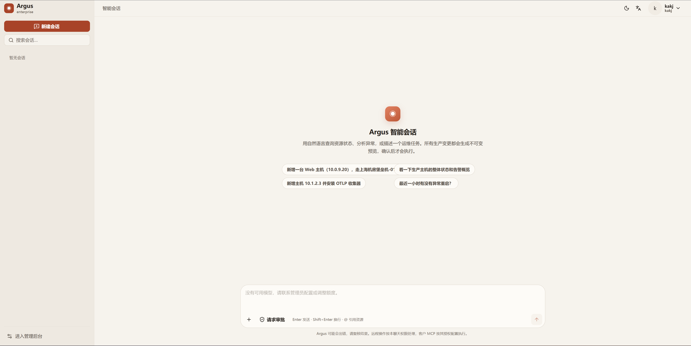
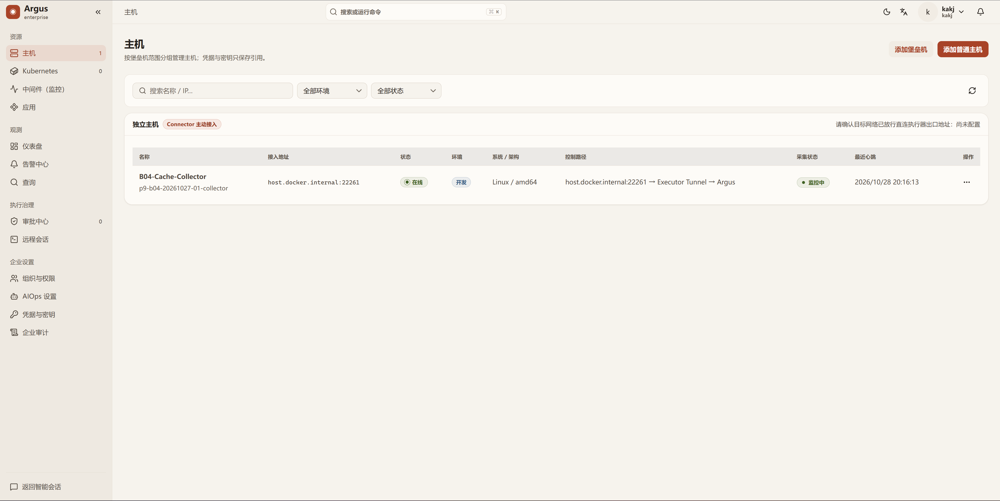
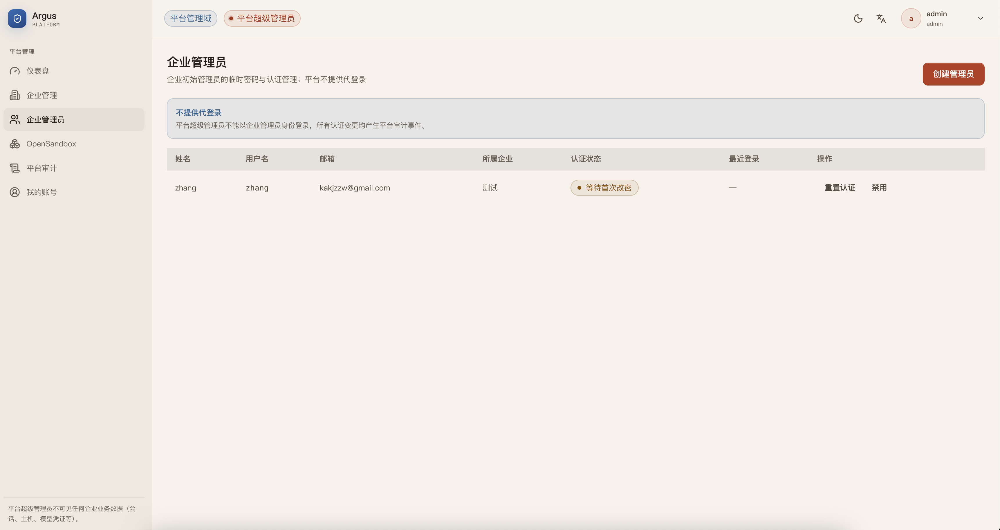

# Argus

<div align="center">


[](LICENSE)


**面向企业的开源 AI 原生运维与可观测平台**

从自然语言提问，到资源查询、异常分析与受控执行。

[核心能力](#核心能力) · [快速部署](#快速部署) · [架构](#架构) · [开发与测试](#本地开发与测试) · [文档](#文档) · [Releases](https://github.com/kakj-go/Argus/releases)

</div>

---

## 概述

Argus 是一个面向 AIOps 场景的多企业 SaaS 控制平面，将智能会话、主机与 Kubernetes 管理、应用监控、遥测查询、仪表盘、告警和远程访问整合到同一工作台。用户可以通过自然语言描述任务，也可以在管理门户中完成配置；两种入口复用领域服务与权限边界。

AI 负责理解意图、分析数据和调用工具。资源授权、变更确认、凭据使用与执行审计由服务端管理，帮助团队在明确的授权范围内开展运维。

> **Beta 状态**
>
> 当前版本为 `v0.0.1-beta`，处于持续开发与验收阶段，不保证历史数据及旧协议兼容。当前部署入口面向 Evaluation；Production Profile 仍受 PostgreSQL 高可用与沙箱隔离架构前件约束，具体范围见[部署说明](deploy/README.md#production-profile)。

## 核心能力

### 🤖 智能会话与工具协作

用自然语言查询资源、分析监控数据、编写运维计划，并在会话中查看工具结果与执行进度。Agent 通过统一 Tool Gateway 发现和调用自有工具，也可以接入企业管理员配置的 Remote MCP。

每个会话拥有持久 Workspace，用于上传附件、分析数据、运行脚本和下载产物；计算环境由 OpenSandbox 管理。平台业务变更使用预览与确认流程，远程请求按会话权限模式和已批准计划执行，客户 MCP 遵循独立授权配置。



### 🖥️ 企业资源与远程运维

统一管理主机、堡垒机、Kubernetes 集群、应用和监控目标。主机通过 Connector 建立控制连接，采集状态和资产信息集中展示；Kubernetes 工作台提供资源浏览、日志、终端和 Helm 操作。

企业管理后台集中配置组织、角色、资源授权、模型、凭据和审计。人工远程会话与 AI 执行分别授权，支持终端停靠、会话记录和操作追踪。



### 📊 可观测与告警

通过 OpenTelemetry 接入指标、日志和链路，使用 PromQL、KQL 与 SkyWalking GraphQL 查询引擎分析数据。观测查询工作台支持多面板排查，仪表盘提供持续观测与 AI 分析入口；内置模板覆盖已支持的主机、Kubernetes、应用和中间件场景。

告警中心统一承载当前告警、历史、策略、屏蔽抑制和通知记录，支持邮件及钉钉、飞书、企业微信机器人通知。具体采集支持组合和验收范围见[监控集成目录](docs/plan8/07-integration-catalog.md)与[告警中心](docs/plan6/README.md)。

### 🏢 平台与企业分域管理

平台门户负责首次初始化、企业和初始企业管理员管理、OpenSandbox 基座及平台审计；企业门户负责本企业资源与业务。平台超级管理员不代登录企业，也不因平台身份获得企业会话、资源或模型凭据的访问权。

两个门户共享 UI 组件与 Design Token，支持中文、英文以及浅色、深色主题，当前正式体验与验收范围为桌面 Web。



## 架构

Argus 使用 Go 构建后端，React + TypeScript + Vite 构建门户，通过 Kubernetes、Helm 和 Operator 管理部署。业务模块保持在统一后端内，控制、异步执行、连接和遥测按职责独立运行。

| 程序                      | 职责                                                     |
| ------------------------- | -------------------------------------------------------- |
| `argus-server`            | 身份与权限、资源管理、业务 API、工具预览与确认           |
| `argus-worker`            | Agent 循环、模型调用、异步任务、Workspace 与受控远程执行 |
| `argus-connector-gateway` | Connector 长连接、命令与文件隧道、人工远程会话中继       |
| `argus-telemetry`         | 以 Ingest、Writer、Query 三种角色接收、写入和查询遥测    |

受管主机运行 `argus-connector`，遥测由 `argus-otelcol` 采集。控制链路与 OTLP 遥测链路分别使用独立入口和凭据。

| 依赖                         | 用途                                         |
| ---------------------------- | -------------------------------------------- |
| PostgreSQL                   | 企业、权限、会话、任务、审批与审计等业务状态 |
| Redis                        | 短期锁、租约、限流、缓存与状态通知           |
| Kafka + ClickHouse           | 遥测缓冲、持久化与查询                       |
| OpenSandbox + Workspace 存储 | 隔离计算与会话文件持久化                     |
| MinIO + OpenBao              | 对象存储与凭据托管                           |

`argusctl` 负责安装、检查、升级、备份恢复及 PKI 管理；`argus-dev` 负责仓库开发、构建与 E2E。详细边界见[产品与架构](docs/01-product-and-architecture.md)、[系统不变量](docs/00-decisions-and-invariants.md)和[部署设计](docs/10-service-components-and-kubernetes-deployment.md)。

## 快速部署

### 获取 v0.0.1-beta

从 [v0.0.1-beta Release](https://github.com/kakj-go/Argus/releases/tag/v0.0.1-beta) 获取适合部署机操作系统与架构的 `argusctl`、配套安装资源和校验文件，完成 SHA-256 校验后解压。容器镜像与 CLI 使用同一版本，镜像仓库地址、支持架构及 Collector/Connector 制品以该版本发布清单为准。

当前 CLI 需要配套配置、Chart、迁移和签名制品目录。请保留安装资源的完整目录结构（包括 `go.mod`、`deploy/` 等定位文件），在其根目录执行以下命令；不能只复制一个二进制后运行无参数安装。

### 前置条件

- 可访问的 Kubernetes 集群和具备安装权限的 kubeconfig；准备 `kubectl`、Docker CLI 及部署验证使用的 `curl`。
- 集群可分配资源至少为 10 核 CPU、15 GiB 内存，部署机可用磁盘至少 25 GiB；实际容量与 PVC 需求以 `preflight` 输出为准。
- 可用的 StorageClass、Ingress Controller（默认 `nginx`）及 LoadBalancer 实现。
- 企业门户、平台门户、模板、制品下载和 Connector 的域名解析，以及浏览器对所用 TLS CA 的信任。
- 集群能够拉取发布清单中的 Argus 镜像和锁定的基础依赖镜像。

### 配置与安装

以版本随附的安装配置为基础，在安装资源根目录保存为 `argus-install.yaml`，调整 Kubernetes Context、StorageClass、域名与镜像仓库。Beta 使用 `spec.profile: evaluation`；从远程仓库拉取时设置 `spec.images.mode: oci-registry`、`tag: v0.0.1-beta` 和 `pullPolicy: IfNotPresent`。

Collector 的制品地址、校验值和签名信息应使用该版本真实发布信息，并与实际部署域名匹配。仓库中的[本地配置模板](deploy/profiles/local-formal.yaml)用于源码部署参考，其中的占位制品元数据不能直接用于安装；完整字段见[配置 Schema](deploy/schemas/argus-install-config.schema.json)。

以下假设二进制已命名为 `argusctl`（Windows 为 `argusctl.exe`）。

**Linux / macOS**

```bash
chmod +x ./argusctl
./argusctl version
./argusctl preflight --config argus-install.yaml
./argusctl plan --config argus-install.yaml
./argusctl install --config argus-install.yaml
./argusctl status --config argus-install.yaml --output json
./argusctl verify --config argus-install.yaml --output json
```

**Windows PowerShell**

```powershell
.\argusctl.exe version
.\argusctl.exe preflight --config argus-install.yaml
.\argusctl.exe plan --config argus-install.yaml
.\argusctl.exe install --config argus-install.yaml
.\argusctl.exe status --config argus-install.yaml --output json
.\argusctl.exe verify --config argus-install.yaml --output json
```

每一步成功后再执行下一步。安装按阶段创建基础资源、有状态依赖、OpenSandbox 和 Argus 工作负载，发布主机接入制品，并执行数据库迁移；阶段状态保存在集群中，修复问题后可重新运行安装继续。

### 初始化与访问

首次安装成功后，终端摘要会显示一次性 Platform 初始化链接。打开链接创建平台超级管理员，再创建企业和初始企业管理员；企业用户从企业门户登录并配置模型、接入资源。

| 入口                 | 配置                                               |
| -------------------- | -------------------------------------------------- |
| 企业门户与智能会话   | `https://<spec.exposure.enterpriseHost>`           |
| 平台管理与首次初始化 | `https://<spec.exposure.platformHost>`             |
| 模板运行时           | 独立域名，由安装配置派生或通过 `templateHost` 指定 |
| Connector 控制连接   | `grpcs://<spec.exposure.connectorHost>:9443`       |

若初始化链接遗失或过期，且系统尚未初始化，可重新生成：

```bash
./argusctl setup-token rotate --config argus-install.yaml
```

升级、备份恢复、证书轮换与卸载说明见[部署与运维文档](deploy/README.md)。

## 镜像与发行组成

Beta 镜像标签统一为 `v0.0.1-beta`。下表列出镜像名称；完整仓库前缀使用 Release 随附配置，基础中间件版本由 [versions.lock.yaml](deploy/versions.lock.yaml) 单独锁定。

| 镜像                                 | 用途                                                        |
| ------------------------------------ | ----------------------------------------------------------- |
| `argus-backend:v0.0.1-beta`          | Server、Worker、Gateway、Telemetry 等后端运行角色与辅助程序 |
| `argus-web:v0.0.1-beta`              | 企业门户、平台门户与模板运行时                              |
| `argus-workspace:v0.0.1-beta`        | 会话文件分析与脚本计算环境                                  |
| `argus-workspace-egress:v0.0.1-beta` | Workspace 网络访问控制                                      |
| `argus-remote-runtime:v0.0.1-beta`   | 经授权的远程执行运行时                                      |
| `argus-install-tools:v0.0.1-beta`    | 安装 Hook 使用的标准 Kubernetes 工具                        |
| `minio:v0.0.1-beta`                  | Argus 构建的对象存储镜像                                    |
| `argus-otelcol:v0.0.1-beta`          | 主机与 Kubernetes 遥测采集                                  |

Collector/Connector 的可执行制品及安装脚本随版本配套提供，由安装流程发布到本部署的制品存储，再供主机接入与采集安装使用。

## 本地开发与测试

### 环境准备

- Go 1.25.8 或更高兼容版本，以 [go.mod](go.mod) 为准。
- Node.js 24、pnpm 11.21.0，以 [package.json](package.json) 为准。
- 完整部署与集群 E2E 另需 Docker、Kubernetes 及上述安装前置条件。

```bash
git clone https://github.com/kakj-go/Argus.git
cd Argus
go mod download
corepack enable
pnpm install --frozen-lockfile
go run ./cmd/argus-dev doctor portable
```

### 门户开发

在两个终端中分别启动：

```bash
# 企业门户：http://localhost:4173
pnpm dev
```

```bash
# 平台管理与首次初始化：http://localhost:4174
pnpm dev:platform
```

这两个命令显式使用 `mock` API，适合界面开发；模拟数据保存在浏览器 localStorage。接入真实服务需显式设置 `VITE_API_MODE=real` 和所需地址，缺失配置时不会回退到 mock。完整业务体验使用上面的 Kubernetes 部署流程。

前端应用位于 `web/apps/`，通用组件统一由 `@argus/ui` 提供，颜色、字号、间距和主题统一使用 `@argus/design-tokens`。工程约定见[技术栈与代码结构](docs/12-technology-stack-and-code-structure.md)。

### 质量检查

```bash
go run ./cmd/argus-dev repo test
go run ./cmd/argus-dev repo vet
go run ./cmd/argus-dev contracts lint
go run ./cmd/argus-dev contracts check
pnpm typecheck
pnpm lint
pnpm test
pnpm build
pnpm build:real
pnpm exec playwright install chromium
pnpm e2e
```

门户 E2E 使用 Playwright，覆盖桌面交互、中英文与浅深主题。集群 E2E 通过真实 `argusctl` 运行安装和验证，使用独立测试资源，例如：

```bash
go run ./cmd/argus-dev doctor e2e
go run ./cmd/argus-dev e2e run --suite planv2 --kube-context YOUR_ISOLATED_CONTEXT --run-id YOUR_RUN_ID --artifacts .cache/e2e
```

集群测试结束后按套件流程清理本次创建的 Namespace 和资源。门户 mock 测试、真实集群与真实模型验收分别记录；适用范围和 CI 门禁见 [PR 与 CI 合并规则](docs/ci.md)。

## 文档

| 文档                                                  | 内容                               |
| ----------------------------------------------------- | ---------------------------------- |
| [文档总索引](docs/README.md)                          | 产品、架构、实现计划与验收入口     |
| [系统不变量](docs/00-decisions-and-invariants.md)     | 企业隔离、授权与执行边界           |
| [部署与运维](deploy/README.md)                        | Kubernetes 安装、配置、PKI 和维护  |
| [主机接入](docs/19-cross-platform-host-onboarding.md) | 跨平台主机、堡垒机中继与快速安装   |
| [Agent、MCP 与 Workspace](docs/planv5/README.md)      | 工具发现、客户 MCP 与持久会话目录  |
| [计划与远程执行](docs/plan7/README.md)                | Workspace 分析、命令授权与会话执行 |
| [应用、监控与 Kubernetes](docs/plan8/README.md)       | 集成范围、工作台与验收状态         |
| [观测查询](docs/plan10/README.md)                     | 指标、日志和链路的临时排查工作台   |
| [告警中心](docs/plan6/README.md)                      | 策略、通知、屏蔽与处理流程         |

## 贡献

欢迎通过 [Issues](https://github.com/kakj-go/Argus/issues) 报告问题和提出建议，或提交 Pull Request。开发前请阅读 [AGENTS.md](AGENTS.md) 和相关设计文档；涉及架构边界的变化需要同步说明原因、影响并更新文档。

功能变更应包含相应测试与验收证据。向 `main` 提交 PR 前完成适用检查，合并要求见 [CI 规则](docs/ci.md)。

## 开源协议

本项目基于 [Apache License 2.0](LICENSE) 开源。第三方依赖的版权声明见 [THIRD_PARTY_NOTICES.md](THIRD_PARTY_NOTICES.md)。
