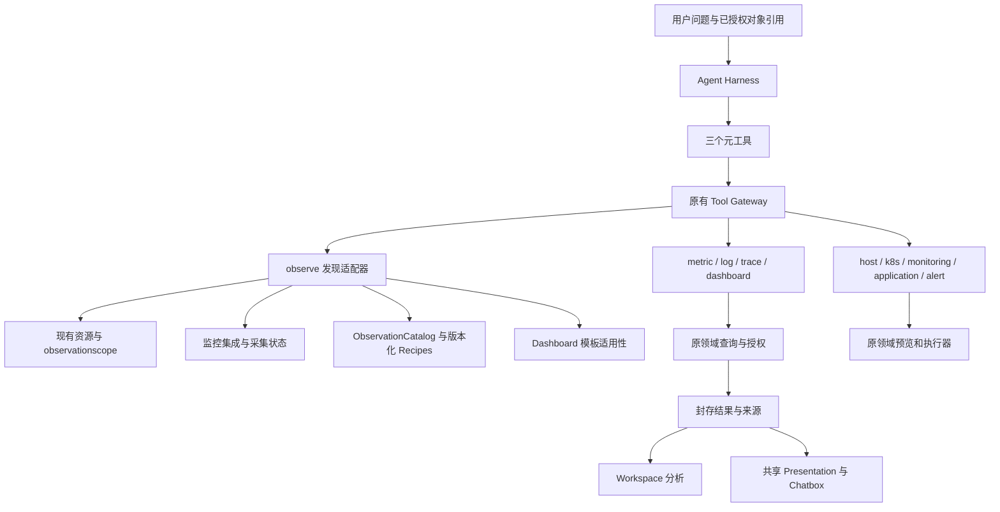

# 整体设计与工具分配讨论

本页结论是实施候选设计。现有不变量继续生效；涉及新行为的项目须实现、验证后才能成为运行时事实。工具名与主要范围依照本轮讨论冻结，路由质量和预算阈值仍由真实评测校正。

## 1. 分类是否合理

当前 11 类并非同一维度：host/k8s 是对象领域，metric/log/trace 是信号，dashboard 是分析载体，workflow 是流程。强行改成单层资源树，会让“查看 MySQL”和“修改 MySQL 采集”重新混在一起。

推荐保留这些执行目录，增加 observe 作为跨领域的观测发现入口。类型化能力导航负责连接对象与工具，不注册 mysql.query/redis.query 等成批相同执行器，也不为每个指标增加函数。

| 维度     | 例子                                                         | 语义与责任                                                  |
| -------- | ------------------------------------------------------------ | ----------------------------------------------------------- |
| 资源身份 | monitoring_target、application、host、kubernetes_namespace   | 授权与稳定对象身份；来自现有资源服务                        |
| 资源家族 | database、cache、messaging、web、probe                       | 查找与解释标签，来自统一集成定义；不是权限类型              |
| 集成     | mysql、redis、kafka                                          | 采集适配与版本；不能直接当 source_type                      |
| 来源     | receiver/source_type/source_key/版本                         | 实际观测出处；一个目标允许多个来源                          |
| 信号     | metrics、logs、traces                                        | 查询引擎及数据范围                                          |
| 意图     | discover、query、prepare、preview、control、deliver          | 找对象、查证据、准备草稿/问答、变更预览、控制任务、交付文件 |
| 结果     | resource_list、metric_catalog、timeseries、pending_action 等 | 模型理解结果；不决定权限或前端加载任意模板                  |

集成与来源不能依名称猜测。例如 kafka 对应的 Receiver 可为 kafka_metrics；HTTP 为 http_check；OTLP 是接收协议，不能把所有原始资源来源改写成 otlp。服务/实例是 Application 下的业务实体，Namespace 是显式选择与授权范围，不能为了统一导航创建新的平行授权根。

## 2. 模块分工

observe 适配器不持久化另一份资源目录、指标目录或授权关系。需要跨服务组合时只生成有界响应投影；领域状态仍有唯一所有者。Server/Worker/目录生成器从同一生产注册定义组装，依赖注入可以不同，业务开关不能意外不同。

## 3. 三个新增工具是否重复

| 工具             | 应负责                                                       | 不应负责                                       | 与旧能力的关系                                               |
| ---------------- | ------------------------------------------------------------ | ---------------------------------------------- | ------------------------------------------------------------ |
| resources.list   | 找到可查询对象及稳定身份                                     | 完整配置、所有指标、主动采集探测               | 复用资源目录；host.list 等继续服务详细领域管理               |
| capabilities.get | 对已知对象给出有界的来源/信号/采集状态/适用仪表盘/下一步入口 | 替模型执行全套诊断、扫描全部历史样本、创建资源 | 组合已有领域事实，不替代 collection.get 的完整配置与诊断详情 |
| catalog.query    | 指标/字段/值/来源发现及推荐表达式                            | 真正执行用户统计查询、代写配置                 | 复用 Plan10；dashboard.catalog 保留创作上下文适配            |

无需每轮固定调用全部三个：已有可信目标身份和有效来源时可跳过 resources.list；已知指标且时间/来源契约完备时无需重新扫描目录。Describe 顺序和当前授权检查不能跳过。capabilities.get 的收益必须由“减少后续试错”验证，若反而增加成本，缩短默认返回并允许省略，不把它做成强制流程。

## 4. 决策表

| ID  | 候选决定                                           | 原因及影响                                        | 状态                       |
| --- | -------------------------------------------------- | ------------------------------------------------- | -------------------------- |
| D01 | 保留三个元工具输入字段；observe 是新业务分类       | 保留确定性发现，顶层不膨胀                        | 本计划基线                 |
| D02 | 四项元数据只描述工具，不是元工具筛选参数           | 避免误解及多套搜索语义                            | 本计划基线                 |
| D03 | 3 新工具、8 项主要业务契约修改；其他工具补元数据 | 原 6 项加仪表盘条件解析和根查询资源确认 | 新增两项按 r29 失败补正，详见第 03 篇 |
| D04 | 新发现目录以资源读权限和显式授权提供能力           | 普通资源读者不必取得 Dashboard 管理权限才能查指标 | 必须完成权限回归           |
| D05 | 默认资源仪表盘使用共享发现服务/构造路径            | 修复 Server/Worker 差异，不把所有模板无条件暴露   | 必须真实复现并修复         |
| D06 | 把任务范围和已获取仪表盘分开存储                   | 普通诊断可组合；专门仪表盘分析保留约束            | 候选已实现；三项真实范围场景通过，完整矩阵待签收 |
| D07 | scope 复用现有类型化查询契约                       | 同步模型与门户；资源与来源不能靠标签授权          | 本计划基线                 |
| D08 | 所有目录有分页/预算/完整性，工具分类列表仍完整返回 | 对象/指标目录可能很大，工具发现不能静默丢工具     | 本计划基线                 |
| D09 | Chatbox 复用共享视图，不复制后台整页               | 保持封存、授权与界面一致                          | 本计划基线                 |
| D10 | 私有模型治理不开放；客户 MCP 不进入 observe        | 不扩张本期权限及外部连接边界                      | 保持现状                   |
| D11 | 无数据、不可用、不支持、未授权分别处理             | 防止模型把未观测说成健康                          | 强制验收                   |
| D12 | 用真实模型比较路由与成本后定稿默认步骤             | “多了一层目录”不自动等于更好                      | 真实模型放行条件           |
| D13 | 首次会话仪表盘分析必须明确资源条件或继承已确认的条件 | 防止条件修错时省略资源，回退默认全部 | 候选已实现，当前 PostgreSQL d07 通过，真实模型待复验 |

r29 英文仪表盘任务在条件证据失败后删除资源补丁，根查询实际覆盖 4 台 Host。新增 D13：`context.resolve` 首次确认具体资源、显式全部或有证据的资源重置；已有条件可原样继承。`query` 再次检查不可变 context 的资源确认事实，旧的隐式全部 context 不能继续执行。自动分析无需新增强制表单：模型可根据问题通过原协议选择资源并记录解释或 AI 选择依据。直接仪表盘页面的确定性查询、现有授权、用户条件保护和发布版本冻结继续由原领域路径管理。

条件校验失败提供固定公开说明及所需的条件相对路径，经过 Agent 的明确允许规则传递；不透传内部错误。验收先检查所有已执行查询的实际资源与时间，再检查模型状态、报告及用量。省略报告或模型请求失败均不能遮住真实范围错误。

## 5. 已发现的设计风险及处理

1. **一套工具查对象，另一套工具查相同对象。** 统一底层目录与对象引用；管理工具保留领域完整 DTO，observe 只提供观测定位。合同测试验证同主体、同筛选返回身份一致。
2. **capabilities 成为无限聚合接口。** 首版最多 20 个显式资源、可选 sections、每节分页与预算。禁止为一次能力查询主动连接目标或逐指标扫描；失败逐节如实表达，鉴权失败不降级。
3. **元数据把适用性误当当前支持。** resource_types/signals 是静态工具能力；动态实际来源与可用状态来自服务端。没有信号的流程工具写空数组；空数组不代表任意资源。
4. **按类型筛选被当成授权。** 所有筛选先后均只能缩小已有授权集合；关系不传递权限，跨应用/共享数据库聚合必须保留实际覆盖。
5. **仪表盘抢占普通诊断。** 新任务范围在 Run 准入时冻结，获取仪表盘只增加分析对象。旧 Run 维持既有语义，不能在恢复时悄悄放宽。
6. **推荐表达式被直接当结论。** 推荐项包含来源、依赖指标、单位和适用性；只有查询成功且实际读取证据才能得出结论。无分母、样本不足或版本冲突明确拒绝该配方。
7. **模型拿到了数据，用户没有合适视图。** 每项公开业务入口必须声明 template/trace/file/action/interaction 等实际交付方式；测试分别覆盖，不以拥有模板判定所有功能完整。
8. **规范越来越长。** 系统提示只保留 12 类简明职责和少量决策规则；细节放 Describe，目录返回有界结果，原始大数据进入 Workspace。

## 6. 需要实测决定的取舍

| 取舍                            | 默认候选                                             | 对照与判定                                               |
| ------------------------------- | ---------------------------------------------------- | -------------------------------------------------------- |
| 广泛健康检查是否优先仪表盘      | 匹配明确且覆盖充分时优先；具体问题优先精确目录与查询 | 对照完成率、遗漏、轮次、Token，不强制所有问题先读仪表盘  |
| capabilities 默认节             | 状态、来源、适用仪表盘和工具引用的紧凑摘要           | 详细节按需读取，量化额外查询成本                         |
| 大 alert/k8s 分类是否进一步拆分 | 先用完整列表与结构化元数据                           | 只有错误归类或成本有证据再细分；当前不增加子分类查询参数 |
| 四项元数据在 Search 中显示多少  | 全部用紧凑枚举数组；完整解释留 Describe              | 测量 38 项 alert 类 Token，禁止按普通结果上限丢条目      |
| 综合诊断入口                    | 普通会话默认综合，用户显式选择“仅分析仪表盘”才收窄   | 验证用户约束可见、可恢复；模型不能自行切换限制           |

## 7. 对上游文档的影响

分类发现协议字段不变；目录枚举、Discovery/Manifest、Catalog Revision 需要升级。Plan8 的资源身份和授权不变，Plan10 的临时工作台不增加保存实体。PlanV2 自动获取仪表盘引起的范围收窄需要在实施 D06 时替换，且同步 Run 快照/恢复/业务预算。当前上游页面仅添加提案入口，保留现行行为描述，直至功能门禁完成。

### D08：观测查询预算的内部存储修正（2026-10-30）

真实 ClickHouse 边界回归证明，直接把大来源集合展开进 SQL 会触及解析长度上限；为 assignment epoch 读取资源属性 Map 会让无关宽属性消耗查询预算。因此大集合使用已有外部表机制，metric_series 增加内部物化 assignment_epoch 列，Telemetry Schema 升至 v6。Query 继续在租户锁内创建、校验与物化；原始属性和样本保留，失败不标记 ready。此次调整不改变用户查询参数、授权根或指标归属排序规则，部署须携带对应 migration，不能混跑依赖不同 schema 的 Query/Writer。候选回退前保留现有制品与数据；本轮不升级正式环境。

### D09：r22 之后的工具分配复核（2026-10-31）

36 项真实对照说明，增加目录入口本身不足以完成复杂用户任务。当前缺陷集中在目录与查询的优先级冲突、错误反馈未说明共享预算已不可用、Schema 前件太晚暴露、保存/交付含义不清及派生统计缺少原件一致性约束；没有证据支持为每种数据库再增加一组查询工具。

继续采用五类观测身份、三信号查询、12 类目录和共享领域服务。已知精确指标直接查询；未知指标优先 observe/catalog.query；capabilities 只在确需采集状态/来源/适用内容时调用，不把三个 observe 工具串成必经流程。原生操作、Preview/Commit、远程命令、客户 MCP 与 Workspace 的权限边界保持原方案。

文件职责保留为 Workspace 保存/计算、workflow 发布不可变交付，在操作返回值中明确保存与交付事实；不增加平行文件写入工具或自动发布所有中间文件。三元协议在 Describe 阶段检查 Search，Invoke 仍核对全链路，四项导航元数据继续只描述能力。预算沿用同一持久账本与保守未知成本规则，通过安全错误契约给出实际可执行的后续选择。

本轮补正属于既有职责的落实，数量仍为 133 个业务工具、最多 9+N 个顶层工具；它们改变模型看到的契约和说明，须用补正后的版本重新验证，不能将 r22 或原型单元测试视为最终版本通过。

D14（2026-11-01）：候选完整质量复验与旧版删失对照分开报告；原18项候选硬门槛保持，完整36对照仅在两组实际完整时成立，相对成本/时延未验证就不作改善结论。原因、执行及统计口径见第13篇。

D15（2026-11-01）：R35 证明正确定位和正确摘要仍不能保证报告正文准确。由共享 Workspace 程序计算逐序列时间/数值事实并组装报告，模型保留生成事实后补解释；不增加业务工具或改变交付权限。原件、表示兼容与正文复核分层记录，设计及当前进度见第11篇。

D16（2026-11-01）：R37 发现 Hash 类型误用和 Counter 累计读数被解释为窗口活动。为原文件明确标注 SHA-256，为离线事实保留真实目录类型及解释限制；结论仅合并无歧义、无冲突的已知 JSON 表示。三个元工具、四项静态导航字段与业务查询权限不变，详见第11篇。

D17（2026-11-01）：R38 证明合法的模型类型参数仍可给出错误事实。类型/单位改由实际授权查询序列的元数据提供，沿已有结果、RPC、缓存和封存链路传递；离线提示只用于一致性检查，不能认证事实。输入元数据与派生结果单位分开，预算及权限边界不变，详见第11篇。

## D20：业务答复与完整机器证据分工

多轮真实任务发现，要求模型在已交付报告之外再次抄写完整数值 JSON，容易遗漏面板、抄错标识并重复大量证据。按当前产品目标采用业务摘要与证据视图/报告分工：原始查询和面板文件保持权威来源，离线程序计算完整事实，受控发布生成不可变交付，Chatbox 最终答复描述业务结论并引用实际交付。完整 JSON 在报告/证据视图按需查看；用户明确要求最终 JSON 时仍必须完整提供。

这是交付契约的显式修订，不改变三个元工具输入、133 项业务工具、数据授权、查询/预算、Preview/Commit、文件 Hash 或来源规则。旧轮次按 strict_json_v1 保留失败，不用新规则重新评成通过。新增 delivery_summary_v2 只用于单独标记的候选业务验收，不能与旧冻结提示做新旧质量比较，也不能降低数值、来源、全部面板、发布、正文事实和用量门槛。

验收仍先检查实际范围边界，再独立验证封存报告的完整 JSON、原查询/面板 Hash 与数值/单位/时间；最终答复必须引用同轮真实交付。如果答复还提供机器证据 JSON，则必须完整并与报告一致，不能用缺字段摘要掩盖冲突。普通正文继续独立复核，机器检查不声称证明所有自然语言判断。未发布报告、错来源、错数值、漏面板和虚构交付继续失败。

## D24：授权写入的可回滚并发冲突

R43 的完整 18 项尚未派发：只读用户授权态 4 项门户和 103 条实际查询通过，撤权 API 返回 409/INTERNAL_ERROR 后停止，撤权态门户未运行；原失败、源码冻结和正式恢复证据保留。原请求可用日志没有底层 SQLSTATE，不直接断言其精确数据库原因。

在独立 PostgreSQL 复现相同共享审计链的并发条件，6 个不同主体授权请求中 5 个实际被 PostgreSQL 以 40001 回滚。测试仅给可丢弃数据库加短延迟以重叠事务，不注入错误码、不在测试端重试。d15 原失败保留；d14 只是夹具 purpose 长度错误，不能算并发复现。

修复范围仅既有 UpdateGrantBatch 的纯数据库事务：保持 Serializable 隔离，在新快照中重复原主体、资源和 caller expected_version 检查，最多 8 次，仅对数据库确认回滚的 40001/40P01 有界退避；未知提交/连接结果、取消及显式版本冲突不重放。授权版本、撤权、审计与 outbox 仍同一事务提交，未更改权限模型或请求输入。未对全局 Store.InTx 自动重试，以免影响含其他副作用的回调。

接口复用现有 VERSION_CONFLICT 和 retryable 表达事务冲突耗尽；真正未分类内部错误返回 500，显式授权版本冲突仍单独处理，不泄露数据库原文。d17 完整授权回归与 HTTP 契约通过：12 个并发授权/撤权提交且审计恰一次；同一主体同一版本竞争只有一个提交，另一请求保持过期冲突，合计 13 条审计，没有合并扩大授权。所有隔离数据库/容器按归属移除；旧源码单行回退副本与 R43 冻结 Hash 完全匹配，新 d17 源码 Hash 独立记录。

该修复不新增工具/元参数、遥测执行路径或发布步骤；R42 的 A06 策略证据仍保留，R43 暴露的并发可靠性另记。修复后的实际撤权与完整 18 项仍需新一轮隔离验收，不把数据库回归当作整体放行。

## D33：同名、同地址目标的已确认区分边界

2026-11-01 用户明确选择：先按资源 ID 和已授权的主机/集群归属区分，信息不足时询问。Plan11 不新增独立网络域管理实体，不将 Collector ID、主机环境或 IP 相同解释成已验证网络域。资源 ID 是选择与执行的稳定身份；主机/集群归属只在当前授权下作为区分事实，多个采集位置或缺失/冲突归属必须保留为不确定性。环境使用应用自身固定环境，不转授关联目标环境或数据权限。

AI 可以沿现有目标、采集实例和授权主机/集群目录继续核对归属，再向用户展示授权内可区分的事实与明确 ID；不得为完成消歧读取无权的主机/集群、默认选第一条或合并同地址对象。A08 的验收按本决策补齐“同名跨环境、同地址不同采集归属、归属不足时询问并绑定回答 ID”，不再以新增网络域字段作为完成前件。已有 R26/d24 局部证据保留，完整真实模型组合仍需执行。

## D40：依据 R50 补齐身份锚点与元数据范围说明（候选）

R50 英文首项只读目标目录、采集状态和 Host.get 后即选定同地址目标，未读取任何 Collector→Host 绑定；另两份中文正文把 production 过滤结果扩展成其他环境的结论。最终 ID 碰巧匹配夹具不能替代关联证据，当前 A08 不签收。

候选修正保持现有服务/权限边界：collection_state 返回当前 CollectionDTO 已有的 configured_collector_id、effective_collector_id，并明确 placement_state=requires_authorized_resolution（均缺失时 unassigned）。它们是配置/生效身份锚点，不是 Host/Cluster 归属、网络域、连通或采样证明。该结果不新增跨域 Host/Cluster 读取或授权；模型必须沿既有已授权 Collector 元数据读取验证同一对象关联，配置与生效 Collector 不同则分开说明，无法建立关系时询问。不能从采集名称、IP、Host 在线或名称后缀猜选。

此处只暴露现有 collection.get 已可见的 Collector 身份，不返回主机/集群名称、地址、凭据或推断环境；目标读权限不足仍整体拒绝。采集绑定/assignment epoch 进入 capability 续页版本签名，防止迁移后旧游标继续使用。capabilities.get 输入和四个节保持不变，输出版本升至 argus.observe_result/v2、发现 revision3；三元工具1/2/3字段、133业务入口/12类和最多9+N不变。

共享观测视图用中英业务标签显示配置/生效采集器与“归属待授权核对”，深浅色沿既有共享样式；不为 Collector 新增查询根或 @ 类型。通用模型指令补元数据证据范围：过滤/分页/权限内结果只证明本次范围，不能判断被排除环境/对象不存在或已读取；有明确 Host/Cluster 约束时必须有实际关联证据。request_user_input 仍要求问题 ID，只补稳定唯一 ID 的描述/例子并提升工具元数据版本，不放松校验、不自动回答或确认。

后续验收继续同名/同IP/跨环境12独立任务，采集配置名称使用中性编号避免暗示归属，原Oracle仍要求独立的同条Collector→Host记录；新增ID字段本身不算完成关系核对。旧轮次、失败及正文质量问题全部保留，不以提示规则或组件回放代替真实模型复验。

## D41：能力查询的本次活动标记（候选）

R51 的配置/环境/归属均有实际依据，但第三个归属任务把 sampling_performed 写成 null；首个询问任务从 stopped/no_data 推导 false。复核确认 capabilities 根结果确实没有返回描述中已说明的 sampling_performed/data_state，仅部分来源条目有标记；来源为空时缺少明确活动事实。最初人工评审误以为字段已存在，已另存纠正记录，不将此错误归给模型。

候选修正只补实际输出契约：capabilities.get 根结果明确返回 sampling_performed=false、data_state=not_checked 和 reason，表示本次能力查询只读元数据、没有执行遥测样本查询；不表示目标从未采样、未配置、停用、健康或历史数据为空。无来源、子节权限不足、部分失败或分页时仍保留这个本次活动事实。发现revision升为4、输出argus.observe_result/v3，输入和权限不变。

共享观测视图在根部以中英业务说明呈现“本次能力查询未读取遥测样本，不代表目标历史数据不存在”，不要求用户理解内部参数或再做确认。继续保留明确布尔验收，不接受用null或从健康状态推导。完成领域/模板/浏览器回归后再做真实模型复验；R51原失败和字段缺失证据均不改写。

## D43：统一采集元数据活动与应用来源覆盖（候选）

R53完整12项身份流程通过，但两份附加正文仍把配置状态当本次活动，或从应用collection_state空列表推出无active monitoring。合法路线可以直接读取collection.list/get而不调用capabilities；只在capabilities补活动字段不能覆盖这些路线。

候选修正限于现有元数据工具：collection.list/get也返回sampling_performed=false、data_state=not_checked和当前请求活动reason，发现revision3/输出argus.monitoring_result/v2，输入、权限和数据执行路径不变。它们读配置记录，不证明目标历史采样情况。capabilities的collection_state节增加coverage=collection_instances_only及说明，特别指出它不检查SDK接入端点/全部来源；空实例不能推出应用没有监控。capabilities发现revision5/输出v4，仍为原四个输入字段及四个节，不新增查询或探测。

模型共用元数据规则明确：采集启停/health/freshness与本次查询活动分开；断言应用无监控前须有当前授权下的来源/接入点覆盖证据，否则只报告实例节为空和未核对范围。共享观测视图显示覆盖范围和业务说明，仍沿既有组件/样式、中英明暗。Preview/Commit、私有治理、MCP来源及审批边界不变。R53原两处质量失败保持，不将后续修正回填到旧答复。

## D45：来源身份、修订项与 SDK 启用状态导航（候选）

R54中文六项基础Oracle通过，但一个中文和首个英文答复把同一source UUID的修订3/5/6说成三个来源；英文任务没有读取请求的端点enabled状态。实际来源查询SQL中current_installation仅表示source.generation等于当前Collector generation且Collector未卸载，不表示最新配置、端点启用、接收中或健康。

候选输出保留所有历史source_key版本选择器，不合并/删除修订：每项新增source_id和entry_kind=source_version_selector，sources节新增当前页page_entry_count及按UUID去重的page_source_count，明确不是全目录总数。完整source_key仍用于后续查询，不能用source_id代替版本/Namespace选择器。current_installation附代际语义，数据状态仍未查询。

应用capabilities.next_tools增加application/endpoint.list身份引用，用于当前SDK协议、信号、enabled事实；不携带填好的执行参数、不返回Key原值。引用仍经现有Gateway当前权限和任务范围过滤，引用不等于Describe或授权。capabilities发现revision6/输出v5，输入与原节枚举、权限、查询引擎不变。

共享观测视图中英区分本页来源数与版本项数，并说明current_installation不是启用/健康。通用模型规则要求按稳定source_id去重，不把注册代际当启用；未读Key等元数据不得声称已读。R54原失败、来源修订原件和未运行五项保留；先过组件与当前PG反例，再复验同一元数据业务目标。

## D46：支持指标的未观测检查保持完整性

检查“支持但未观测”指标时，只有当前授权来源、时间窗口内完整且为空的定向查询，才允许返回 observed=false 的定义。扫描预算失败继续返回预算错误；当前请求内部的已观测列表和后续定向检查共用剩余扫描预算，不能逐项重置。

d51 的真实 PostgreSQL 授权/来源解析配合受控数据后端复现：定向检查返回不完整空结果时，系统未添加假定义，但外层仍标 complete=true。现传播 complete=false，并保留 SUPPORTED_METRIC_OBSERVATION_CHECK_INCOMPLETE 原因；不能把它显示或解释成“确认没有指标”。原已观测阶段列全之后，定向检查遇到一个实际匹配即可证明已观测，该检查自身的分页不制造假缺口。输入、查询根、权限、三元工具参数及数据预算不变。

采集证据与模型证据继续分层：d47 在实际隔离 ClickHouse 验证同名指标五个来源/类型/单位组合、分页和真实扫描预算错误；d48 通过实际 Go SDK、原生 Collector、mTLS Ingest、Kafka、Writer、ClickHouse、授权 HTTP，验证 Counter=5、Gauge=7、Histogram count=3/mean=0.2s 以及两次实际累计观测上的 rate。原始输入类型/单位/来源在同源查询引擎另行核对，旧 HTTP 信封没有这些描述字段，不声称由 HTTP 返回。未据此替代真实模型语义或全部集成验收。

## D47：按实际返回序列验收，区分外推速率与观测计数

R56 首项实际模型通过两次合法查询完成数值取证：正则批量选择器返回三类指标及 Histogram count/sum/bucket，另一条返回 rate；两份完整查询文件均实际读取。原驱动误以为五项数值必须有至少五次查询，且只接受单序列 instant。验收改按实际返回序列和原始输入元数据解析，支持 vector/matrix 与批量 Histogram 家族；取窗口末端实际评估值，保持单一应用、来源版本、窗口、原件 Hash/大小和读取事实，不把工具次数当业务事实数。常量替代、类型/单位冲突、重复歧义序列、缺少末端点及 offset/@ 改时仍拒绝。先导出全部封存原件，再做业务结论检查，避免失败后丢证据。

该驱动问题不抵消模型正文中的实际缺陷：R56 把少量累计样本的 rate×600 秒说成“窗口约10.7次请求”和窗口活动强度。共享模型解释规则与 metric/query 描述明确 rate/increase 是可外推的估计；查询成功、partial=false、评估时间和 loaded_samples 不能证明连续原始覆盖，更不能自动得出已观测事件总数。缺少原始事件或充分的计数边界/重置证据时，实际窗口计数保持未知。查询引擎和数值不修改；PromQL 发现 revision8，输入/输出版本、三元输入、业务数量和权限不变。

离线 Workspace 脚本的 write/edit 与 bash/read 都属于分析工作，不因业务只读任务一概判为生产变更；原生配置变更、远程探测、凭据及外部工具仍不在本次模型场景范围。R56 原轮次失败、9次调用及剩余5项未运行均保留；原文件的完整 read 投影去掉读取追加换行后与原封存 Hash/大小精确相等，标为校验副本，不冒充当时新增下载。数值路线重放通过不等于原轮次或全文改判通过。

## D48：无效时间在共享计量前拒绝，来源版本不伪装成标签

R57 首项发现目录正确，但模型将瞬时求值理解为 from=to=窗口末端，另用未观测的 argus_source_revision 标签代替 scope.source_keys。首个执行返回通用失败，后续同批三条被共享预算拒绝，未取得任何数值；模型最终如实报告未知，不能计数值完成，也不能据此验证 D47 的 rate 正文。内部精确错误未写入诊断，初步原因来自代码路径；后续受控回归确证无效时间会进入计量后端。

统一模型查询预检在任何语言编译/预算后端之前检查非零且 from<to，包括瞬时查询。无效输入返回安全 TOOL_QUERY_INVALID，明确 budget_reserved=false，保留原用户窗口和资源范围；不放宽计量、未知完成的保守扣留或执行预算。有效瞬时查询省略/零 step_seconds，在 to 求值，仍携带原正窗口。普通时间/表达式错误应允许同一 Run 修正，不能先消耗整笔后再要求用户重开。

PromQL 输入字段结构不增加：from/to/step_seconds/scope 补充精确说明，InputVersion=v2，发现 revision9；OutputVersion=v2、查询引擎、三元工具输入和授权保持。来源版本由实际目录的完整 scope.source_keys 指定；修订不是自动存在的指标标签，标签名和值须来自实际目录，不从数字版本自行构造。

## D49：本轮查询证据清单与消费状态（待实现验证）

R59 两项实际模型的来源、正时间窗、数值和 rate 估计边界均正确，但第二项四份查询原件只读取其中两份，却声称全部已核对。现框架只保证文件交付，不持续呈现本轮文件消费状态。拟在每轮重新组装的 server execution facts 中增加有界 query_evidence 清单，复用持久 ToolCall/ToolResult/Artifact/WorkspaceFile；不建立平行证据仓库、不改查询引擎、不增加工具或确认流程。

清单只纳入当前 Run 的成功自有三信号查询，身份从框架记录的 target_tool_id 及封存 Artifact 推导，不相信返回中的伪造路径；每项先按当前授权校验，再给出查询ID、原始SHA/字节数与已交付路径。Workspace 不可用、原件副本已修改/缺失、授权撤销时不得保留旧路径或标为可读。数量有界并明确截断，不把本页当全体。

“完整读取已验证”只接受实际成功 read 的完整内容与封存 SHA/大小一致，不以同路径调用、工具成功、模型自报、部分行读取或文件元数据充当证明。一般 bash 程序无法仅凭命令字符串证明处理过哪个完整文件，应保持“未由框架核实”，避免把未知改写成成功。模型可以对参与结论的文件继续实际读取/离线处理；清单不强迫读取无关历史文件，也不阻断普通对话。压缩/重启后从当前持久事实重建，历史清单不能扩大当前授权。

另需使基础统计说明准确：算术均值=sum/count，会受极端值影响；Histogram 的 count 不是秒，sum 才使用输入单位，均值保留时间单位。未查询的P95保持未知，不附加未经证明的一般化统计结论。D49必须经过当前PG授权/部分读/篡改/外部伪造/数量边界和实际模型复验，不能凭新增提示签收。

## D50：已观测指标的表示与查询方式

R60已验证两项模型都读取全部贡献原件，但第二项把经典显式桶 Histogram 当作原生 Histogram，使用 histogram_count(base)/histogram_sum(base) 和直接 base，返回空后仍未使用实际存在的 _count/_sum；因此观测数/均值未完成。这是目录路由契约不足与模型选法错误，不把错误查询方式的空结果解释为无观测。

复用当前可信指标类型：histogram 对应经典显式桶，exponential_histogram 对应原生，summary 单列。只给实际已观测且类型确定的条目补 query_methods，含 representation、可由当前引擎执行的 count/sum/mean 表达式及输出单位。经典使用 _count/_sum，原生使用对应函数，Summary 不发明桶。表达式以安全转义的精确指标名构造，仍需保持当前授权来源版本、标签和原正时间窗，不填入调用参数，不授予权限，不执行探测。必须检查真实输入元数据和标签，防止后缀指标与恰好同名的普通指标冲突。方法不是观测值，unknown/支持但未观测条目不伪造表示或方法。

query_methods 是现有目录输出的可选扩展，observe/catalog.query OutputVersion=v2、发现revision2；公共OpenAPI/Go/TS及共享Chatbox详情同步。DataCatalog RPC仍使用原JSON信封，不新增protobuf字段、查询引擎、工具或采集来源。Counter派生单位明确 rate 为原单位/秒，increase 为区间估计增量、保留原单位，不混为每秒。

验证必须覆盖实际Writer/ClickHouse经典、原生、Summary方法与后缀冲突，再走实际SDK→Collector→队列/Writer→授权HTTP目录取方法并执行，最后做双语明暗桌面展示和真实模型复验。契约生成的Windows Node退出崩溃及恢复过程单独留证，不能以部分生成状态开展模型验收。

## D51：真实 Sandbox 来源、合法离线读取与独立场景收集

R61已实际使用目录的经典Histogram方法，数值/单位/来源/窗口正确；循环sha256sum与Python拼接路径读取全部五份原件。旧验收只按命令中的字面文件路径匹配而误拒；该原轮次保留失败，不因此重评分。验收允许已确认的成功离线分析回执：当前真实Sandbox进程、完整非partial输出、原件的精确路径/SHA及对应分析结果，结合实际JSON读取程序与独立下载原件核对；不把任意echo、校验和/元数据单独当作分析证明，也不把任意bash自动标成产品complete_read_verified。

实际轨迹同时揭示D49来源假设错误：生产Workspace read/bash的Source是sandbox，而此前PG夹具使用argus，导致真实读取始终显示未核实。当前查询证明过滤和夹具均按真实sandbox标记，仍独立校验当前授权/Run/文件内容，排除客户MCP及错误来源。直接读取的原字节校验抽到共享toolruntime函数，原件Hash/长度/partial约束不放宽；等价相对/绝对Workspace路径正规化后比较。

合法原始选择器的or可以合并查询，不能凭输出项数推定两侧都返回；按实际返回typedseries取证。空的探索查询只贡献空证据，不能充当所需数值或无历史观测证明；后续仍必须取得全部所需非空事实。普通业务/数值/读取判定失败继续收集其他独立场景，在整轮保留失败；授权/副作用/范围等硬边界或模型准入失败仍立即停止，不把未运行场景计通过。

R61另有真实正文错误：把语义上不应混合的Gauge/Counter或物理单位，解释成PromQL引擎一定拒绝。当前共享说明明确浮点聚合可以执行但语义错误，成功不等于单位验证；observe/catalog.query发现revision3，输出v2及输入/工具数量保持不变。D50实际查询方式正确与全文质量问题分别记录，仍需新完整模型场景验收。

## D52：框架认证完整小结果可直接分析（用户已确认）

用户选择“允许框架确认完整的小结果直接分析；大结果或截断必须读文件”。R62六项所需数值均正确，但旧消费Oracle无法识别多种合法离线读取；首项四份约2KB的实际模型summary又与各自封存原件严格等价。原轮次机判和两项真实正文错误保留，不追溯改分。

原生三信号成功查询增加可选inline_original_complete。框架仅在原件不超过32KiB、非partial、实际脱敏/裁剪后的summary与完整JSON无损等价时认证；比较保留JSON数字，精度变化、删字段、脱敏、预算裁剪均失效。客户MCP、普通目录、模型自报标记不能自证。旧事件缺字段按false。投影v1增加可选输出字段，三个元工具输入、业务数量和查询版本不变。

每次实际请求重建query_evidence.inline_original_in_context，要求当前Run/授权、原件Hash/大小、ready Workspace副本身份一致，并且当前真实tool消息与该原生持久投影严格等价。历史摘要、压缩后消失的原文、user消息、改写副本或撤权均不能继续认证。为保持保守边界，副本不可用时仍要求恢复可用原件后分析。清单本身不复制数据或授予权限。

true允许直接分析当前summary，无需重复物理读取；false/缺失、大结果、截断或完整性未知仍读取实际原件。原件封存和自动Workspace交付屏障继续保留。统计/换算继续由标准库与原始数据计算；完整可见不证明采样连续、数值解释正确或业务健康。答复保持简洁业务摘要与已有证据卡片，完整JSON按需查看；用户明确要求的结构结果仍完整。

新验收analysis_evidence_version=v2独立下载每份原件，核对可信原生认证投影与字节/Hash，并检查之后实际成功推理的上下文事件范围及快照边界。有效文件消费继续接受，未知读取保持待复核。复合OR的合法探索可保留零贡献，不推测被OR丢弃的序列，最终全部数值仍需独立可识别原件证明。此决策改变消费规则，不放宽授权、数值、类型/单位、来源/时间窗或全文质量门禁。

## D53：当前可见、实际历史消费与探索零贡献

R63六项实际任务均正确取得所需数值、所有成功小原文获D52认证且各项offline调用为0，证明直接分析路径已生效。46次实际模型调用用量完整，原机4/6；两个机判失败分别为合法集合表达式及不用于最终数值的复杂探索。全文独立3/6通过：Counter只能看增量的过度概括、压缩后仍声称全部原文在当前上下文、英文任务用中文及均值original标志自相矛盾分别保留。不得把数值正确等同全文正确。

当前上下文可见性与已消费事实分开。inline_original_in_context继续只描述本次真实tool消息，不因历史标记变true。新增inline_exposure_verified：框架在实际请求dispatch事务中，从已验证的当前query_evidence及真实tool消息提取最多64项查询ID/原件SHA/大小，绑定实际provider request hash，写入现有model_calls.inline_query_receipts字段；只在该推理成功且已dispatch、请求Hash和原件身份精确匹配时作为历史完整曝光事实。未发送、失败、未知、错Hash、旧无凭据事件均不认证，不按事件范围或模型自报倒推。当前Run/授权及ready Workspace副本身份仍每次重检，撤权/篡改/不可用失效。

已有完整曝光可以复用已建立事实，不谎称完整原文仍在当前请求；需要已缺失的原文细节时仍读文件。大结果/partial/截断和未核实消费仍走原件分析。历史消息JSON解码改UseNumber，防止重新组装时整数精度变化。此项只增加已有模型调用记录的有界私有凭据列，不新增证据实体、原文副本、业务工具、查询授权、审批或最终回答阻断；Migration52及sqlc同步。凭据无样本/密钥，不能作为数值正确性或采样覆盖证明。

模型指引使用用户要求的语言与简洁业务摘要，不复刻应用已有卡片、不向用户复述内部认证字段、不附加未请求换算或教程；累计读数本身有意义，增量/速率用于区间活动。统计/换算的原件和计算规则不变。验收未识别的有界探索保留原件并贡献零项数值，不能替代任何最终所需事实；所有最终值仍由可识别真实查询独立证明，来源/时间窗/类型单位和硬权限检查继续执行。每Run导出增加实际请求Hash、凭据和压缩边界元数据，避免清理后丢失过程证据；旧轮次保持原结果。

## D54：量值语义和校验状态显式输出（候选）

R64四处全文失败中，两处源于把“单位1本身不证明比率”过度推广到已确定的主机利用率，两处将未执行的期望manifest校验误说成不一致；其中一处另有时间先后表述错误。改输出契约提供准确语义，不引入模型最终回答阻断，不追溯改分或降低90%门槛。

量值定义扩展在既有builtincollection包：只有已注册host_metrics的hostmetrics来源、精确CPU/内存利用率名、实际gauge和原单位1匹配时提供ratio/percent建议及版本化定义引用。原值、单位、类型不修改。原生查询在既有授权snapshot.Query.Keys/Rows内绑定精确SourceID、host归属和SourceKey，输出argus_meta.input_metric_semantics；这描述输入量值，不描述任意派生表达式结果。目录每项semantics还要求其全部SourceKeys均匹配本次已授权来源类型。SDK/custom、未知指标、冲突类型/单位或外部来源不因同名/单位1继承比率。

Workspace助手只在原件Hash/原始输入元数据完整、非派生结果且每个所选来源均有一致定义时让auto选择percent；明确identity仍尊重用户原值要求。旧/未知单位1保持identity，字节仍按既有规则显示GiB。不增加RPC protobuf字段，原生输出在控制平面已解析范围内补语义；公开目录OpenAPI/Go/TS和共享中英视图同步。

Dashboard助手增加manifest_checksum_status=not_requested|verified及解释：未提供期望值不是不一致；实际不一致仍抛错误，不生成成功已验证证据。新格式移除旧布尔字段；旧封存原件不改写。报告Markdown中英明确显示此状态；模型不得从false推定失败。该状态只说明校验过程，不授予来源权限、不证明数值或连续采样。

版本：PromQL输入v2不变，输出v3/发现10；observe.catalog输入不变，输出v3/发现4；Workspace契约v8。metric_evidence/v6、dashboard_evidence/v2分别为可选量值元数据与显式校验状态，旧封存原件保持原版本，不回填。三个元工具输入、133/12工具分配、授权、Query Engine、Preview/Commit、审批和证据交付屏障不变。

## D55：原件身份类型、端点值与累计量解释范围

R65六项实际功能路径和原件/报告数值均通过独立核对，包括两份实际超过32KiB的CPU原件、截断预览后的全文件分析、具体来源比率定义以及manifest原字节导出/v2状态。原机0/6来自验收器将生产uuid.UUID误按string读取，导致ID为空；原机结果保留。已修正为只接受合法非空uuid.UUID或其字符串形式，六项真实记录以两种类型重放通过，不增加模型调用或改判旧结果。

全文仍4/6：中文仪表盘把CPU最小值4.22%误当首点（实际5.39%）；英文仪表盘从累计量递增形容区间网络活动很低且平稳，缺少相应区间证据。补通用程序事实：单序列面板明确给出first_point_value/last_point_value/value_mean，多序列保留各自端点，Markdown列实际时间—端点值，不以min/max代替；已核实的原始counter证据增加interpretation_limits，活动强弱/稳定性标not_established_by_this_input。其他已验证的速率/边界证据仍可单独使用，该限制不声称整个会话从未计算速率。

Workspace契约v9；metric_evidence/v6、dashboard_evidence/v2增加可选事实，原始数据、授权、Query Engine、工具数量/元工具输入/审批不变。不加入自然语言最终回答阻断或并行证据实体。46项助手测试和两组R65实际原件回放通过；仍按具体范围签收，不将程序事实正确冒充全文或整计划通过。

## D56：诊断结论的证据范围与实际业务验收

R66五项真实任务已关闭。中文筛选的显式typed Host引用与重复resource_types数组等价，旧字面检查误判；两项实际筛选输出及解释正确，原机4/5保留。浏览器目录因软断言跳过，范围目录名含下划线被公共校验拒绝；这些属于验收脚本缺口，不冒充实际页面通过。修正为接受等价typed范围但拒绝冲突/额外ID，软断言独立留存后继续只读UI检查，使用规范后缀并等待异步工具轨迹。两份实际原件回放通过，不追溯改写旧轮次。

三项范围执行均正确，但全文各有未验证推断或时间错误。共享模型说明明确：请求窗与实际首末观测分开；极值位置和UTC必须由原始时间—数值对计算，未计算就不写精确位置；低利用率不足以证明整体健康，网络IO不证明错误/丢包、路径镜像或因果，缺点原因未核实不得归因引擎/外推。继续使用简洁业务摘要和应用的证据卡片/报告，不增加自然语言最终阻断、第二证据实体、工具或权限。D52、所有原始数值、查询/预算/审批及Workspacev9协议不变，实际请求Hash记录当前指引。

新增显式plan11-publish验收阶段，复用五项范围/筛选任务并增加中英文个人草稿两项，七项初始任务的总调用验收上限224，作者两项及确认后续Run合计上限64，兼容探针另计。模型从真实Host目录/来源创建两图草稿、复用编辑器校验与样本、提供发布预览；实际Chatbox逐一验证中英/明暗及刷新不确认，然后取消一项、明确确认一项，独立核对零取消发布/一个确认版本/新幂等键重放拒绝。observe只读发现不获得创建、隐藏Commit或确认能力。当前仅实现，须完成当前PG/工程与真实模型/页面验收，不预签A19/A21/A22。

## D57：领域导航、历史范围显示与作者目录同源语义

R67实际七项与94次模型调用已关闭，427源码Hash未变、正式恢复passed、namespace零、核心1/1。两个筛选任务均只读capabilities，未完成组合匹配；中文还将空链接误说成部分适用，属于真实业务失败。三项范围执行通过，但历史限制徽标缺失：服务端真实user_message保存了task_scope，前端timeline漏传；不是后台范围丢失。两个作者任务均产生校验和预览，中文符合要求；英文将原始内存字节命名为百分比（CPU实际排除idle，旧人工复核中的全部状态表述另有更正），业务判据正确拒绝。发布UI未执行，不能签收A22。范围正文仅1/3完整正确，原时间/健康/峰值错误保留。

职责修正：capabilities.dashboards继续按单个资源返回导航链接，复用已有scope_note说明其范围；组合资源的type/signal/integration交集及partial状态仍由dashboard.list的同一领域匹配器计算。两者公开Search/Describe说明、下一工具用途与共享中英界面同步，不把组合匹配复制到observe。发现修订caps7/list4，caps输出v5及三元输入不变。实际目录浏览器改用现有openToolResults并只检查Presentation iframe，不能用模型正文冒充界面标签。

历史用户事件与公共消息共用严格task_scope枚举解析，保留当时服务端录入的限制。三条R67实际事件回放通过，不根据斜杠文本倒推权限、不修改历史、不改变后端拒绝策略。限制/恢复实际UI随后只需各一个短确认任务，无须再跑复杂网络分析。

作者目录之前走按名称合并且any(unit)的旧查询，真实返回缺少来源身份，D54量值定义无法复用。现修复既有有界名称目录：保留按名称分页，一次查询汇总实际来源键；类型或单位冲突明确置mixed/未知，完整分项仍使用observe的metric_variants查询，当前授权复核后才附同一builtin定义及从发布模板提取的配方。未知、错误类型/单位、外来键、非Host或不完整来源不认证。作者目录输出v2/发现3，公开OpenAPI/Go/TS同步，RPC不新增字段。普通门户和模型调用同一领域方法；下拉框保留变体、按名称汇总说明，冲突或目录未完整时不拿第一条认证类型/单位。作者目录继续现有trace交付，可按需查看字段，不新增平行卡片或最终自然语言阻断。草稿语法/样本有效不代表用户请求的数量或标题正确。

后续采用最小范围复验：两个筛选任务、两个只设置限制/恢复且不取数的真实任务，以及需要补验的两个作者任务，共6个初始任务；范围执行L5沿用R67，新增UI检查专门验证修复。具体预算和放行证据须在启动前封存，当前工程/PG与实际复验尚未完成，不增加整项签收。

补充单位复核：R67两份CPU均实际排除idle、按state细分，并非查询全部状态；先前截断展示造成的人工误述已另存更正，原索引报告不改。英文原始内存By错误仍成立，两份原始利用率直接用percent格式也会少显示100倍。现有草稿样本/发布校验增加QUANTITY_DISPLAY_MISMATCH，仅对来源精确匹配、完整且原始的数值元数据判定：原始By不能直接百分比，已知Host利用率分数需percent_ratio或显式100x。未知/元数据不全/派生表达式不猜单位，原数据和最终自然语言流程不改。前端反馈中英复用同一消息映射；draft.validate/publish.preview发现修订3，修复数量显示后再确认。主要契约口径为9项字段/资源改动加2项校验行为，共11项；业务入口仍133。

量值校验改变了既有准备/发布的有效性规则，因此Dashboard编译/校验标识升argus.dashboard_compiler/v4；旧v3的发布计划由既有publicationState版本检查失效，避免沿用旧样本/校验结论确认错误单位。JSON Spec版本和原始观测不改，历史证据继续按原记录版本复核。两份R67实际样本已在当前确定性校验中回放，均检出显示单位冲突，原机判不改。

## D58：作者样本与发布范围、已知配方单位

R68六任务/66次调用关闭，453源码Hash未变、恢复passed、namespace零。英文筛选完整完成，中文完成组合partial和logs无匹配但未单独取单机metrics基线；原机4/6与该缺项保留。实际目录4组和限制/恢复8组全部通过。结合当前PG及R67完整范围执行，A19/A21按业务条件分层签收，整体25/35。范围短确认不冒充具体Dashboard ID已采纳或锁定。

作者实际暴露两项缺口：英文在修复单位后丢失资源参数，样本扩大到五台授权Host；这是请求范围扩大，不是越权企业泄露，原失败保留。中文CPU使用已发布0–1配方却选percent，原始指标限定规则未涵盖已知派生配方。发布确认UI仍未执行，不签收A22。

模型的draft.validate/publish.preview现要求parameters.resource_mode=explicit、resource_types、resource_ids；显式空数组表示不取资源，缺失不能退回全部授权。建议入口绑定仍只作导航，不作为取数范围或授权。发布复用既有ExecutionInput与领域Verifier扩展，按调用者给定范围重新校验，API/Go/TS与门户转发一致；门户若已有当前草稿样本，发布预览保留该样本资源范围。不会新建Scope实体或复制Query Engine，也不让模型提交自证书。

单位验证只补精确匹配的已发布配方：表达式规范化相同、配方版本/输出单位已知，且全部输入元数据完整、来源当前授权且内置量值一致，才可判定percent_ratio与percent不匹配。未知派生表达式仍不推断单位。既有编译/校验标识升v5使旧v4发布计划失效；draft.validate/publish.preview Inputv2、发现修订4。三元输入与业务入口数量不变，仍11项主要改动。

下轮只选plan11-authoring的两项真实作者任务（含后续总上限64，探针另计），沿用实际Host/Collector前件，不重复已通过的导航/限制任务。当前工程与PG和实际复验尚待，不提前签收新策略。

## D59：查询说明与错误恢复的一致性

R76显示模型可执行相同窗口/来源的经典及原生Histogram方法，但综合诊断重复使用上游contains语法。现有反馈只列管道阶段，缺少实际包含谓词。复用共享常量将body : "text" | limit 100同步到发现说明、输入字段和语法错误，保留实际编译器、执行前不计量、当前授权与固定资源时间；不另建查询引擎或扩宽语法。日志发现revision3、链路revision5；两者历史结果说明同步用户已决D52消费规则，旧原件不改写。三个元工具输入、133/12、9+N、业务契约结构/数量、Workspacev9不变。

验收安全分类按真实业务能力：metric.overview是只读覆盖，不是变更/探测或指标数值，白名单允许发现使用仍要求真正指标查询。错误说明缺口与真实任务未完成分别记录，不能用修复测试器推导旧轮次通过或默认降低90%质量门槛。

## D60：三信号证据消费与结果含义一致

R77原件证明查询执行正确并不保证正文正确：链路duration被误说为微秒，日志severity_number=9误说为ERROR，目录65条/22名被口头误数。工具发现说明明确当前真实解析器的毫秒单位、OpenTelemetry日志级别；共享模型指引区分目录条目、指标名、来源ID和来源版本，精确计数须实际计算，否则省略未核算总数。空的observed目录不证明未发送或采集停用。

三信号统一复用D52消费说明，删除指标发现里残留的“无条件读文件”矛盾表述：框架认证且当前上下文可见的完整小原件直接分析；大结果、partial、裁剪或完整性未知仍实际读取原件。指标/日志/链路发现revision分别为11/4/6；业务输入输出结构、133项/12类、三个元工具输入、Workspacev9、封存/授权/预算/确认边界保持既定设计。

本轮测试修正独立记录：预算错误识别真实原生TOOL_QUERY_BUDGET_EXCEEDED及领域代码；指标标签页面只点击记录的展开按钮并检查共享详情，不再误点排序菜单。四种只读语言/主题用例各自执行，单项失败仍保留。中文验收问题把资源类型与完整UUID明确分隔，服务端不修补或猜测身份。R77原机失败及全部正文错误不重评分；压缩失败原因尚不能仅凭4096输出token确认，不把它当网络或额度错误。

## D61：生产工具注册是启动前必检项

R78在服务启动时实际发现D60指标结果说明为1108字符，超出既有发现Schema的1024上限；原轮失败、0业务模型调用、原件和正式恢复记录保留。相关包及编译通过未覆盖生产注册，不能作为启动成功的替代。说明精简后保留D52及返回评估点/原始采样/请求窗的区分，指标发现revision12；Schema上限和业务协议不变。

启动前检查纳入现有nativetools的133项实际生产注册/搜索测试，另逐项使用生产NormalizeDiscovery校验遥测发现说明。先有原失败和现有注册负例，再修复并确认通过。R78主进程exit1、485源码Hash不变、正式恢复passed、namespace零、正常核心1/1；未执行的模型和页面不得记通过。d101当前ClickHouse实际分页/冲突/50万历史行/1万来源选择器扫描预算，d102当前PostgreSQL观察分类/权限与共享预算并发结算各自通过并清理；受控存储与真实采集证据分别标注。

## D62：目录元数据到实际查询，及当前页确定性计数

R79九项真实任务113次调用、原机4/9；14份原件SHA/大小/窗口核对，实际重建通过，但综合诊断漏查、原生均值未查询、目录误数仍失败。一次MODEL_COMPATIBILITY_FAILED无Provider用量，保留未知，不能把占位0当零消耗。中文语义任务读取约7KB完整投影的搜索目录子集后，反复在容器文件系统寻找尚不存在的数值查询原件，没有调用指标查询。这与真实已收到原件的英文任务可直接分析是不同阶段。

明确流程为“目录选择名称/类型/来源/方法 → Search/Describe实际查询 → Invoke取数 → 按D52分析原件”。目录complete=false可表示筛选子集，不等于原件被裁剪或不可读；继续游标或收窄范围，不能猜测result_ref为文件路径，也不搜索容器根目录、环境或系统日志。query_evidence为空在首次取数前是正常状态；有当前授权查询方法时，先取得用户要求的值再交付，不能仅因尚未查询就结束为null。禁止取样的元数据任务、预算和权限限制继续遵守。

observe.catalog.query新增page_counts，仅对已授权、已返回的当前工具页计算metric_entries、distinct_metric_names、source_entries、distinct_source_ids、distinct_source_versions、field_entries及value_entries，scope=returned_page。它不增加扫描/数据库查询，不代表全局库存或模板可视子页。目录输出v4、发现revision5，输入和三个元工具不变。实际R79页面65条/22名/1来源/3版本及8条/6名的目录回放独立核对；模型可直接引用这些确定性口径，无需自行口头估数或寻找目录文件。

验收驱动增加显式--plan11-signal-tasks子集，默认仍9项；白名单、去重、固定顺序和阶段限制在环境准备前检查，准入原件登记真实任务名和32×任务数的调用验收界限。子集不冒充完整9项或最终18项质量评测。保留实际数据前置条件、来源/窗口、原始失败和完整恢复；不增加生产工具或权限。

## D63：共享指标视图的单位、时间与嵌套标签

R79实际指标原件含可信Gauge单位1，页面却只看序列标签而显示“未附单位”；将返回评估点时间称为“最近采样”也会误导。共享MetricContext仅在result_is_original_metric=true、input_metrics_complete=true、origin=authorized_series_metadata且名称/来源描述唯一时补齐原单位和完整来源版本；派生表达式、类型/单位歧义、外部提示及不完整描述不继承输入单位。只补显示上下文，原始值和标签不改。标准SDK服务/命名空间/实例标签用于业务维度；维度1不附重复数字后缀，不自动转换百分比。

共享指标模板将返回点和最新评估点明确命名；最新原始采样只在query元数据声明observed_query_samples时单独显示，不能把查询整体的最新采样分配给每条序列。三信号/仪表盘公共查询文件标签统一称“查询结果数据”，不再把普通指标文件叫仪表盘数据。业务查询协议、Workspacev9和原件内容不变，模板Hash自动触发现有版本边界。

标签对象仍用共享RecordValue折叠树、安全文本渲染。R79行详情已展开但内层标签未展开，4项原失败保留；当前脚本补齐内层summary。独立Go原件回放验证单位/来源与值未变，实际原件SHA核对后以当前Go显示归一化结果做4种桌面语言/主题的受控Chatbox回放，验证标签可见、无伪造确认、单位及两种时间正确。受控L4不冒充新自主模型或当前来源授权验收；真实日志L4及标签L5另引用R79，947模板测试覆盖真实共享视图分支。

## D64：导入本会话授权结果是离线分析，不是业务变更

R80原始硬停止来自验收器漏列workflow.import_result。该工具本来就由workspace.use、当前Run/会话/来源权限和Workspace路径约束，只复制公开结果供离线分析，不发布文件、不执行远程命令或确认操作；信号验收已允许read/write/edit/bash，同样应允许该精确入口。只修未来测试白名单，publish_file、计划及其他业务动作仍拒绝，权限与生产代码不改。原2项/41次调用、机判0/2/硬停止、英语2项未运行、源码495不变和完整恢复均保留。

逐份核对8份指标原件与最终正文后，中文语义任务已真实完成累计Counter5、Gauge7、经典count3/mean0.2、原生count3/mean0.2、重置感知速率及类型/单位变体，来源和窗口一致；实际错误后缀空查询经原生函数恢复，不解释为无数据。按A13的领域/真实链路/自主语义取数层评审，不把原验收器失败覆盖为通过。普通诊断仍漏查且时间结论错误，A25和最终当前18项完整质量门槛继续待验。

## D65：压缩恢复必须衡量真正的下一轮请求

R81当前18任务实际出现两次600秒超时：压缩任务完成后不断重新调度Agent，而没有新的推理进展。一例产生308个压缩任务、294个Agent任务，实际只有21次推理及2次压缩模型调用。诊断发现currentContextFits没有重建持久推理轮次指令、最后轮的工具抑制及模型预算参数/推理配置，因而与实际Loop衡量不同请求。

共享inferenceRequest用于实际派发与恢复尺寸计算；恢复先读取CountRunInferenceCalls，应用相同inferenceTurnContext及协议能力字段，再用相同RequestBytes和原硬界限判定。用完轮数仅恢复到原有终结逻辑，不额外派发。保持原保守字节策略、24轮限制、131072/8192测试模型配置、配额、授权与未知写入规则，不扩大上下文或强行绕过超限。

d104真实隔离PostgreSQL边界回归复现旧请求35260字节可通过hard35261、实际下一轮35387字节超限；新恢复判据不重新排入相同超限请求，无法缩短时明确终止。远端事实超限与原进度规则也复验通过，原R81超时及整轮失败保留；受控账本行不是新Provider或遥测证据。

## D66：发布显示标题与实际文件格式分离

R81实际已发布一份4171字节Markdown，但自定义标题没有.md后缀，旧发布逻辑只看标题而将其标为application/octet-stream，后续Markdown验收未识别。不得将它解释成模型从未发布，原交付ID/Hash/媒体类型及未导出字节状态分别留存。

沿用现有文件分类：显式media_type优先，其次有效显示名后缀，最后实际Workspace路径；未知格式仍为二进制。保留原始字节、标题、Hash及访问/来源约束，不把重命名当格式转换。publish_file发现revision2说明此规则，参数与输出结构不变。新增实际P5上传→本地脚本Provider原生发布→对象存储→授权HTTP下载回归；--p5-publication-only只选择该范围且禁止真实模型配置，不冒充完整P5或L5。P5受控模型窗口与现有M4相同为131072，避免陈旧32768夹具无法容纳当前固定请求；生产模型配置不改。

文件元数据格式与下载传输格式分别校验：交付media_type识别Markdown供预览/报告分类，现有下载接口统一以application/octet-stream、attachment、nosniff传输并提供内容Hash的ETag。R83曾错误要求HTTP本身为text/markdown，原测试失败保留；未来回归严格核对元数据Markdown、下载原字节/Hash和既有附件安全头，不修改下载契约。R82缺少隔离Ingress的准入失败同样单独留存，测试使用已有ARGUS_E2E_ISOLATED_INGRESS创建本轮入口，不修改全局控制器。

## D67：思考深度由用户在模型设置中配置

按用户要求开放已有版本化 reasoning_effort 到模型设置表单和列表，增加通用 medium 枚举；默认/低/中/高/最高由供应商兼容性测试确认，不静默映射。保留 Chat Completions 显式档位、Responses 供应商默认的现有协议边界；变更生成新版本，活动 Run 保持原版本，不改变授权、工具数量、输出上限或默认自动降级策略。具体分配与验收见[模型思考深度](./15-model-thinking-depth.md)。

## D68：返回评估时间比较由证据助手计算

R86原件及报告数值正确，但模型摘要将180秒误称2分钟、将晚于请求起点误称早于，完整质量仍失败。复用已有Workspace数值助手，添加evaluation_window可选元数据（独立argus.evaluation_window/v1）与双语时间事实表：请求时长、返回首末点跨度、首点评估时间减请求起点、末点减请求终点，以及before/equal/after。按带时区RFC3339及纳秒小数计算；正差为晚于，负差为早于。数据缺失保留未知，不据跨度推断连续原始采样或摄取完整。指标原件与每个仪表盘target分别计算，保留原始Hash、单位、点数、身份、所有序列和原授权链路。既有metric_evidence/v6及dashboard_evidence/v2增加可选嵌套字段，不改三元工具、注册工具数、查询引擎或执行权限。

模型解释引用这些程序事实，缺少时省略精确时间差；不改写模型正文、不覆盖旧报告、不把组件补正当L5通过。下一轮独立隔离验收声明同一glm-5.3-flash的high、8192输出上限，当前medium准入HTTP400保留，保存的模型配置不动。先六项聚焦复验，通过后再决定完整18项门槛是否具备条件。

## D69：有界报告回执与明确点数总体

R91六项机器5/6、完整事实4/6：D68时间关系已正确进入已发布报告，但中文仪表盘因缺发现步骤和重复手工检查耗尽24轮，未发布；英文将4条序列合计12点写成每条12点。原失败、未发布报告未完整封存状态、101次完整Provider用量与正式恢复分别保留；R92完整18项因前件失败未执行。

复用argus-evidence-report，默认stdout改为不超过8192字节的argus.evidence_report_receipt/v1，完整JSON及逐序列/面板表继续保存在原输出文件。回执对实际写入字节逐份核对Hash/大小，验证报告只有一个与JSON文件一致的完整程序证据块，返回指标汇总、总点数、序列数、每序列最小/最大点数、原始partial真/假/未知、限制，以及仪表盘job/attempt/target数量和数组结构。回执明确saved_in_workspace、published=false；仍需正常Search/Describe/Invoke发布，不能据回执声称交付完成。输出采用UTF-8/LF避免Windows换行导致Hash断言不一致。--print-evidence显式返回完整JSON；大结果/未知细节仍读实际文件。

指标和面板数值证据新增point_count_basis=all_returned_series；指标query_partial缺失为null，不冒充完整。已有JSON/Markdown保持完整，超长摘要字段或文件路径明确标记省略，回执超限拒绝而非静默裁剪。回执是本地计算及文件一致性事实，不是授权或来源签名，不放宽封存、资源、工具或审批约束。共享指令要求生成后根据回执正常发布，仅在缺所需事实或实际出错时继续检查文件，避免为确认JSON形态而反复读取。

## D70：验收协作取消与失败归因

R94完整轮次声明18项，已执行早期任务后出现明确时间关系反向，以及context_compaction_failed未交付报告，已无法达到17/18。停止时Windows终端中断终止了本机执行器，未走完自动恢复；原生UID/namespace/PVC/PV恢复及本轮资源清理已单独执行，保留中断和恢复全过程。后续不得用终端中断替代正常取消。

argus-dev e2e run为本轮产物目录监听cancel-request.json，只接受action=cancel及相同run_id，拒绝过大、畸形、额外字段、不同Run和非普通文件；cancel-ack.json只表示已观察到取消，不能当清理完成。该控制通过原有context取消、当前Run停止、会计等待和基于UID/归属的cleanup退出，文件不授予模型或业务工具权限。只有本机操作者能写CLI产物目录，离线Workspace模型路径与其隔离。对照驱动将操作者取消与真实硬边界失败分别返回，不把取消伪报越权。

R94流日志记录HTTP200响应体unexpected_eof及响应头EOF、TLS握手重试；因此至少部分压缩/用量缺失来自实际流失败，不把未完的部分正文误判为模型正常完成。已发HTTP请求后的未知用量继续未知，不补0、不从projection_hash冒充HTTP请求Hash。
