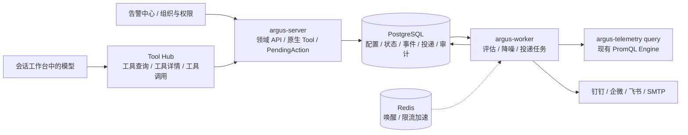

# 架构与契约提案

2026-10-18 Plan8 讨论修订：[最新决策](../plan8/11-grilling-decisions-and-upstream.md)明确一应用一环境（生产/测试分别建应用）、SDK自动发现服务、Namespace独立授权及显式运维日志读取、完整K8s/Helm/CRD管理。监控仅采用可内置Collector的官方/成熟组件，不部署独立exporter或JMX采集服务；无合格专用内置采集方案的资源/模式留证暂缓，通用Prometheus抓取不算外部资源支持；默认仪表盘自动升级，全部支持范围统一发布。[身份与授权契约](../plan8/02-domain-data-and-authorization.md)扩展本页旧Host/Cluster范围；下述旧类型/流程与既有验收属于迁移前基线，不代表新增能力已实现。企业隔离、标签不授权、真实来源及现有确认边界保留。

本文件是 Plan6 的实施基线提案。示意对象、接口和工具名须在 Task01 固化为 OpenAPI/JSON Schema、SQL migration 和生成客户端；不能将文档中的草图作为已存在接口。

## 服务边界

- 拟新增 `internal/alerting/{policy,evaluation,event,noise,notification}` 领域边界，复用现有存储事务、任务领取和审计适配器；每文件不超过 2000 行。
- argus-worker 承担调度、查询、状态转移和通知投递；复用现有普通 Worker Deployment，不使用可执行任意地址或生产 Shell 的 Direct Executor。
- 查询经过现有 ResourceQueryActor/Scope、mTLS RPC、Budget 和来源约束。PromQL 引擎仍在 Query 进程，不在 Worker 中重建第二个查询引擎，不绕过 Query 直接扫描 ClickHouse。
- PostgreSQL 保存唯一业务事实、租约/fence 与 Outbox；Redis 清空不能丢失活动告警、持续时间、静默和投递状态。

## 对象与标识

| 对象 | 必要信息与职责 |
| --- | --- |
| AlertPolicy / Revision | enterprise_id、名称、范围、评估主体、规则、独立/AND/OR、频率、持续/恢复条件、通知引用、启停与乐观版本 |
| RuleCondition | 稳定 rule_id、PromQL/构建器、维度、等级、阈值、恢复阈值、NoData/Error 行为与结果类型 |
| EvaluationJob / Result | 固定时间槽、版本、授权/来源快照、租约/fence、完整性、逐条件结果与评估错误 |
| AlertInstance / Episode | 指纹、资源/来源/维度、生命周期、等级、首次/最后观测、当前值、开始/恢复时间、版本快照 |
| AlertEvent | 只追加的触发/等级变化/恢复/配置终止/屏蔽/解除事实；处理记录单独关联 |
| HandlingRecord | 确认、认领、负责人、评论及操作者；不改变评估结果 |
| Silence / Inhibition | 显式范围、匹配条件、起止时间、原因、创建者、配置版本；抑制源/目标及 equal 维度 |
| NotificationChannel / Route | 渠道类型、受控目标、Secret 引用、模板、路由匹配、目标引用、分组与发送时机 |
| NotificationGroup / Delivery / Attempt | 成员事件、去重键、冻结载荷、当前投递状态、受理/失败/未知结果、重试记录 |

指纹包含 enterprise_id、policy_id、条件分支、resource_id、source_id 和规范化维度；等级和实时数值不进入指纹。独立模式每个规则产生实例，复合模式每组匹配维度产生一个实例。修改表达式、范围或匹配维度后使用新评估代次，旧事件记录 `configuration_changed`，不伪造健康恢复；只改描述/接收点不重新触发异常。

评估状态为 Normal → Pending → Firing → Recovering → Resolved；NoData/Error 和授权失效单独记录健康与原因。异常退出、超时、部分结果、NaN/类型错误不能判为恢复。持续计时基于连续成功的固定评估槽；失败槽的策略须配置并测试，不能用 Pod 内存或 Worker 墙钟推测。

构建器的观测查询与阈值谓词分开保存：先识别观测是否存在，再判断是否超限。高级 PromQL 若已将比较条件写入查询，空向量不等于采集缺失；需要明确的观测存在性检查或单独缺失条件，不能把没有超限样本误标为 NoData。

## 授权

- enterprise_id 仅从当前登录身份或受信任务解析；标签只是过滤，不授权。
- 策略拟绑定已有企业 ServiceAccount 作为后台评估主体。创建/更新校验发起人和评估主体的明确资源范围；绑定账号不自动授予新权限。后台每次执行与写回重查主体状态、授权版本和范围。
- 页面/工具按当前用户的功能权限与资源范围读取；跨资源聚合结果只有完整覆盖参与资源才可读取，不能缩小集合后冒充原聚合。未授权对象不可通过计数、列表、历史、导出、通知内容或错误泄露。
- IAM 沿用现有 RoleBinding、DataAuthorizationGrant、ServiceAccount 与注册表；不新增 Project、业务组授权或第二套告警 RBAC。
- 告警权限候选：alert.read、alert.policy.manage、alert.silence.manage、alert.notification.manage、alert.handle。审计与角色调整优先复用现有 audit/role 权限；最终清单、升级行为与前端生成矩阵在 Task01/07 固化。
- 通知目标由具备渠道管理能力的用户明确配置。通过通知会披露的数据范围须在预览中呈现，Secret 永不成为消息模板变量。

## 降噪与投递

1. 成功评估先持久化实例和事件，再计算静默、依赖/等级抑制与通知分组。
2. 去重减少重复事件；合并只组织通知和可展开视图，成员事件保留。
3. 静默/抑制不取消评估和历史。只暂停通知；记录哪个配置导致受限，并保证同企业、同显式资源/匹配维度。
4. 路由可关联多个目标；同一事件/渠道/配置版本/通知阶段只生成一个持久 Delivery。
5. Delivery 与事件同事务 Outbox 持久化，Worker 条件领取租约并校验 fence。
6. 渠道受理不代表成员已读；HTTP/SMTP 不提供幂等时，崩溃后可能出现未知结果或重复投递，须记录 Unknown 并受控对账/补发，不能承诺外部 exactly-once。
7. 失败分类处理 timeout、429、5xx、业务错误、签名错误和 SMTP 临时/永久失败；重试遵守平台限流，设置次数/期限与失效目标。迟到触发通知发送前重查恢复、静默、权限、渠道状态和路由版本。
8. Webhook 各自固定协议适配，受控出网、防 SSRF/重定向绕过；SMTP TLS 和凭据使用现有 Secret/Credential 机制，审计/日志/预览脱敏。

## API 与工具候选

领域 HTTP 拟采用 `/api/v1/alerts/{policies,events,history,silences,inhibitions,channels,routes,deliveries}`，包括详情、分页、试算与处理记录。时间范围/过滤/排序/完整性须有版本化契约，游标绑定主体、范围、查询和版本。

| 工具类型 | 候选名称 | 行为 |
| --- | --- | --- |
| 只读 | alert.policy.list/get、alert.event.query/get、alert.history.query、alert.notification.query | 返回范围、时间、分页/完整性、健康和状态来源；查询不到规则与规则无告警分别表达 |
| 策略变更 | alert.policy.create/update/state/delete.preview + 隐藏 .commit | 一次冻结策略与多个规则，宿主确认，原子提交 |
| 降噪变更 | alert.silence.create/update/delete.preview、alert.inhibition.*.preview + 隐藏 .commit | 展示范围/期限/影响；删除也重新校验授权和版本 |
| 通知变更 | alert.route.*.preview、alert.notification.test/resend.preview + 隐藏 .commit | 引用受控渠道；测试/补发也是外部副作用 |
| 处理 | alert.event.acknowledge/assign/comment.preview + 隐藏 .commit | AI 发起的业务写入走两阶段；人工明确操作可复用领域命令与审计 |

实际指标值通过现有 Metrics 查询工具取得；告警工具提供规则到指标的关联索引和事件查询，不增加裸 SQL/任意网络工具。告警业务工具只注册到现有自有 Registry / Tool Hub，由会话工作台中的模型经 `tool.search`（工具查询）、`tool.describe`（工具详情）、`tool.invoke`（工具调用）自行发现并使用；不直接向模型注入告警业务工具全集。Commit 永不被发现或由模型直接调用。

`alert.event.query`只返回当前normal/pending/firing/recovering实例，始终排除resolved/closed；其工具Schema不接受历史状态筛选。`alert.history.query`返回resolved/closed的条件与健康事件，按授权范围保存触发快照和处理事实。当前工具的空页、时间筛选或complete=true都不能证明历史不存在；恢复历史必须独立发现并Describe历史工具。指标核对沿用实例state.metric或策略原表达式，不能以平均不同CPU state序列等猜测聚合替代既有规则语义。此次契约澄清保持HTTP路径、分页、权限、三个元工具和隐藏Commit边界。

详情时间线的完整规则/来源快照继续保存在领域结果、不可变artifact和Presentation。自有领域可通过Metadata.Project提供单独ModelSummary；Gateway与Agent沿用既有模型投影、授权和敏感字段过滤，并绑定完整结果的hash/result_ref，不替换完整Data。告警event.get投影在instance保留一次触发快照；每个event保留处理人、评论、值、状态、降噪原因、时间、版本、资源/来源及snapshot_ref，去除重复内嵌完整快照并明确原文可由result_ref读取。这个实现落实既有原始结果/模型投影/展示分离边界，保守请求字节预算与完整Tool组压缩门禁保持。

告警中心只提供六个业务配置与列表 Tab；会话工具使用现有工作台消息与宿主确认。权限矩阵与告警审计位于组织与权限，复用 role/audit API 和现有授权服务。

Preview 冻结版本、范围、授权版本、参数与一次性提交能力，返回公开影响与模板引用。确认后 Action Executor 提交；参数不可再次由模型补写，重复确认幂等，撤权/版本冲突/过期要求新预览。策略和全部规则在一个 PostgreSQL 事务中提交。大结果沿用 Tool Projection/Workspace，完整性和未知状态显式报告。

## 当前落地边界（2026-10-08）

实现使用 `internal/alerting`，通用版本化配置表与不可变版本记录、实例、事件、评估来源快照、投递及尝试记录。普通 Worker 消费 `alert-evaluation` 和 `alert-notification`，持续计时和发送状态均以 PostgreSQL 为事实，复用现有运行时 Fence。通知 Worker 的凭据用途绑定具体任务、投递和渠道，仍由现有 Secret Broker 解密。

正式 API 使用 `/alerts/configurations`、`/alerts/instances`、`/alerts/history`、`/alerts/deliveries` 等领域路径。变更在配置与命令 Preview 中返回现有 PendingAction；隐藏 Commit 由内部 Action Executor 执行。原生业务工具归入 Tool Hub 的 `alert` 类别，变更卡片沿用会话宿主的确认和取消控件。

渠道、策略与规则的数据结构由 OpenAPI 生成；通知原始密钥通过既有写入式 Secret/Credential API 加密保存。预览只包含配置与安全引用。通知记录保留 Unknown 及受控补发路径，不通过自动重发制造确定的成功结论。

全局路由、合并、模板和无显式范围的降噪配置，要求发起人覆盖评估账号的资源授权。账号绑定不授予权限。回滚告警表时保留通知凭据类型，避免删除或使既有加密凭据失效。

降噪创建/修改必须显式提交 `resource_ids` 数组；指定主机或集群时使用已解析的 UUID，标签 matcher 不替代资源身份。只有明确选择全部授权范围时提交空数组；省略或 null 不再隐式扩大范围。此收紧不增加 IAM 或授权边界，避免模型遗漏身份参数后形成更宽的待确认方案。模型验收在确认前检查冻结参数和实际资源范围。

协议接收器仅用于临时验收环境；真实模型调用选定 GLM-5.3。外部机器人群和真实邮箱联通仍作为独立待配置项记录。

### 2026-10-09 接续可靠性与读取投影

- `handling_version` 独立于持续评估版本；处理 Preview 使用 `expected_handling_version`。纯数据库幂等事务对 PostgreSQL 40001/40P01 有界重试，通知发送始终在事务之外。
- 发送批次冻结载荷并绑定唯一任务、Fence 和全部成员；发送前崩溃可重领，开始外部副作用后的不确定结果进入 Unknown。补发创建独立投递并引用原投递，不覆盖历史。
- 凭据签发/消费阶段区分凭据停用、租约失效与底层 SQL/Broker 故障；底层错误保留阶段和原始 SQLSTATE，交给现有 Fence/任务恢复处理，不能永久化为凭据不可用。恢复前仍未跨越发送边界；解密值在成功或失败路径均清除。
- 评估保存每规则及资源/来源的健康与完整性。完整的 AND/OR 参与组可以推进，其余缺失成员保留活跃状态；资源没有来源时单独记录 NoData。
- 实例 API、工具、历史和导出的触发快照只投影该实例的实际参与资源/来源；完整策略和原始不可变数据库事实保留，完整配置另按全范围授权读取。搜索限定公开业务字段，不搜索隐藏的全策略快照。
- 组织审计沿用现有存储，告警确认/取消使用同一范围；关联 Run、ToolCall、PendingAction 和 Execution。审计范围在数据库分页前裁剪。
- 现有会话服务端事实补充 `current_time_utc`，模型据此把“即刻、一小时”等相对时间转换成告警契约要求的绝对时间；不另增时钟业务工具。屏蔽时间仍在 Preview 冻结并由宿主确认。
- 告警结果模板以 `api/schemas/alerts/result.html` 为单一来源，后端嵌入、Mock 由契约生成器同步；结果保留授权范围、评估健康、最近评估和分页完整性，沿用现有隔离 Template Runtime 与宿主确认卡片。

### 元工具的描述与调用时序

模型在目标类别内完成授权工具搜索，获取同一 category/name 的成功 Describe 响应后，再在后续轮次填写参数并 Invoke；关联工具的名称或另一工具的描述不能代替其自身 Schema。同一工具的 Describe 与 Invoke 不放在一个并行响应批次中。工具发现改为只传 category 的完整授权列表；权限裁剪及隐藏 Commit 保持原边界，业务执行继续校验授权和 Schema。验收保留搜索/描述/调用顺序的严格断言，失败前保存完整工具输入、call_sequence、时间、状态、结果及模型样本，避免仅有摘要无法复核。

窄范围配置更新先读取完整当前配置，逐字段保留未请求项（包括描述、规则 ID、范围和通知），不自动同步叙述性文字。验收在确认前和提交后复用同一精确字段不变量，确认前的额外变更拒绝不会发送确认，冻结 Preview 保存供复核。

告警发现元数据区分规则配置/存在性与当前实例生命周期。CPU/内存/主机/集群等当前告警问题应发现实例查询，并读取实际授权范围、最近评估、健康及完整性；策略列表或指标本身不能证明当前无告警。发现元数据仍按版本校验，工具列表不依赖关键词匹配，示例与结果说明明确事实来源，不在宿主中预选业务工具。

策略更新使用完整规则快照，每条规则必须显式携带 UUID；已有规则复用当前 ID，新规则由调用方提供新 UUID。领域校验拒绝更新中遗漏身份，不再把遗漏 ID 自动解释为新规则；创建仍生成可重放的确定身份。Tool Hub 的 policy.update 专用输入定义要求 id，HTTP 与 UI 更新走相同领域校验。该约束不更改 Preview/宿主确认/隐藏 Commit 的边界，避免窄阈值修改重建未修改规则的事件身份。

Plan6 完整 runner 保留 M3/M4/P5 Native/M7 的隔离 Replay 前件。在进入 Plan6 业务阶段前，以同一冻结源码重新构建 GO_BUILD_TAGS 为空的正式 backend，使用不可变 digest 更新临时环境 server/worker/网关/遥测等工作负载，以及工作台 IO、连接器与工具实现版本配置。前件与正式构建的镜像证据分别保存；已完成前件 Job 的旧镜像保留为历史，活动业务 Pod 必须符合正式 manifest。候选保存拒绝未完成正式构建切换的状态；正式发布使用该构建的同组镜像，不发布 m4e2e 构建。

正式构建切换覆盖所有本轮所有权明确的 system、sandbox 和 observability Namespace，逐一记录 Namespace/Deployment UID并等待就绪。server/worker及网关、直接执行器、PKI、三类遥测服务均是覆盖前件；镜像核验解析活动 pinned 引用的原 repository/tag 后检查 manifest digest，不允许旧 pinned引用绕过。正在退出的Pod保留删除时间和镜像事实，不作为当前副本。

自监控配置包含原有Collector Replay Preview前件，必须在正式backend切换前完成并等待就绪；生产切换与Plan6业务都拒绝未准备状态。来源隔离测试的owned Host Collector安装/卸载是受控fixture，通过正式HTTP Preview和宿主确认操作并记录Action/Execution，不是模型验收。该fixture限定已有M7 Host、install/uninstall及p6-identity前缀；M7原有Replay前件和Plan6 GLM工具顺序、确认、取消与状态断言保持必需。

镜像证据保存经过SHA验证的OCI root→目标platform manifest→config描述符链。运行时返回platform/config ID时，Pod必须显式固定同一root且ID属于该链；未固定config、错误root、异平台、描述符歧义及字节替换均拒绝。self-collector固定原Collector root并导入CRI规范引用。候选复制/发布根manifest digest保持严格一致，不将config ID代替候选root。

正式构建下的隔离HTTP/SMTP接收器采用本轮公开CA的标准信任配置。runner先验证临时Namespace、fixture Helm TLS Secret所有权和接收器证书DNS，再仅向临时server/worker追加CA目录；保留系统及已有根目录、完整Host/TLS验证，公开CA单独ConfigMap且不挂私钥。该配置不写入候选镜像或正式Helm values，正式构建不使用m4e2e Replay TLS例外。

正式backend滚动切换会重建Direct Executor中的临时系统Host sidecar。Plan6来源隔离测试在切换后通过真实连接测试、Host Preview/宿主确认和Connector注册准备新owned Host，先保留旧Host状态，并在既有Collector API执行安装/卸载、实际OTLP和Query匹配断言。该准备属于隔离fixture，权限和主机在线状态由真实领域接口及数据库验证，不直接把旧Host状态改为online；正式Host与业务数据不参与。

配置启停与删除的Tool Hub输入仅含现有id和expected_version，不接受name/spec重写；领域服务读取当前完整快照切换状态或保留删除审计范围。启停发现包含状态更新同义词，以原AND检索找到专用动作；全量update留给配置编辑，模型仍自主搜索/Describe/Invoke并由宿主确认。该收紧不改变既有HTTP契约、权限、隐藏Commit或精确变更断言。

临时Connector外部转发绑定具体Pod。正式backend滚动替换网关后，runner在同一本地端口重连当前所有权明确的Service，保持TLS主机名/CA和固定访问地址，拒绝端口变化。转发是临时接入生命周期，不改变产品路由或最终connector-forward-tls检查；证据记录Namespace/Deployment UID及相同端点。

候选复制解析imagetools的containerimage.descriptor.digest，兼容旧containerimage.digest；双方存在时必须一致，缺失/非法/冲突均失败。根digest保持原验收root，额外从目标Registry读取root和platform原始字节验证SHA及config链，防止仅凭CLI metadata误判。该修复不改变镜像、业务或验收准入。

既定告警Describe后Invoke要求由实际Tool Hub执行边界验证持久事实：同企业/主体/Run、较早step且不同model_call、成功Describe的category/name/当前manifest version和成功ToolResult。缺少时返回TOOL_DESCRIPTION_REQUIRED及安全恢复指导，业务不dispatch；存储失败也阻止调用，授权与Scope/Schema仍重查。模型可取得Describe后重新调用，失败的前件拦截不能算业务执行；验收只排除明确被门禁拒绝且失败的尝试，成功Invoke仍必须满足原先前序要求。该落实不增加入口、元工具、模型权限或确认能力。

## 新建门户策略的默认渠道（P6-UI-R01）

`AlertChannelSpec.default_for_new_policies`保存于既有配置JSONB，沿用`alert.notification.manage`、凭据引用校验及Preview/Commit版本与审计；无需新增表、迁移或权限。仅作为门户新建草稿的可配置初值，允许多个已启用渠道，使用当前租户授权读取返回的实际ID。读取加载/失败期间不开放草稿编辑；读取成功后一次性初始化，后续刷新不能重置已打开草稿。编辑/复制、已有策略及API/工具明确传入的`channel_ids`不自动改变。布尔false保留在归一化配置及公开预览中，开启和关闭都可审阅。

## 2026-10-14 模型配置边界收敛

自有告警模型目录为 38 个工具。settings/channel/grouping/template 保留列表查询，其创建、修改、删除及渠道启停模型入口已移除；管理门户与领域 Preview/Commit 保留。策略、屏蔽、抑制、通知路由、处理动作和通知测试/补发仍可通过模型发起预览。详见[模型目录收敛](../planv5/tool-catalog-pruning-20261014.md)。
