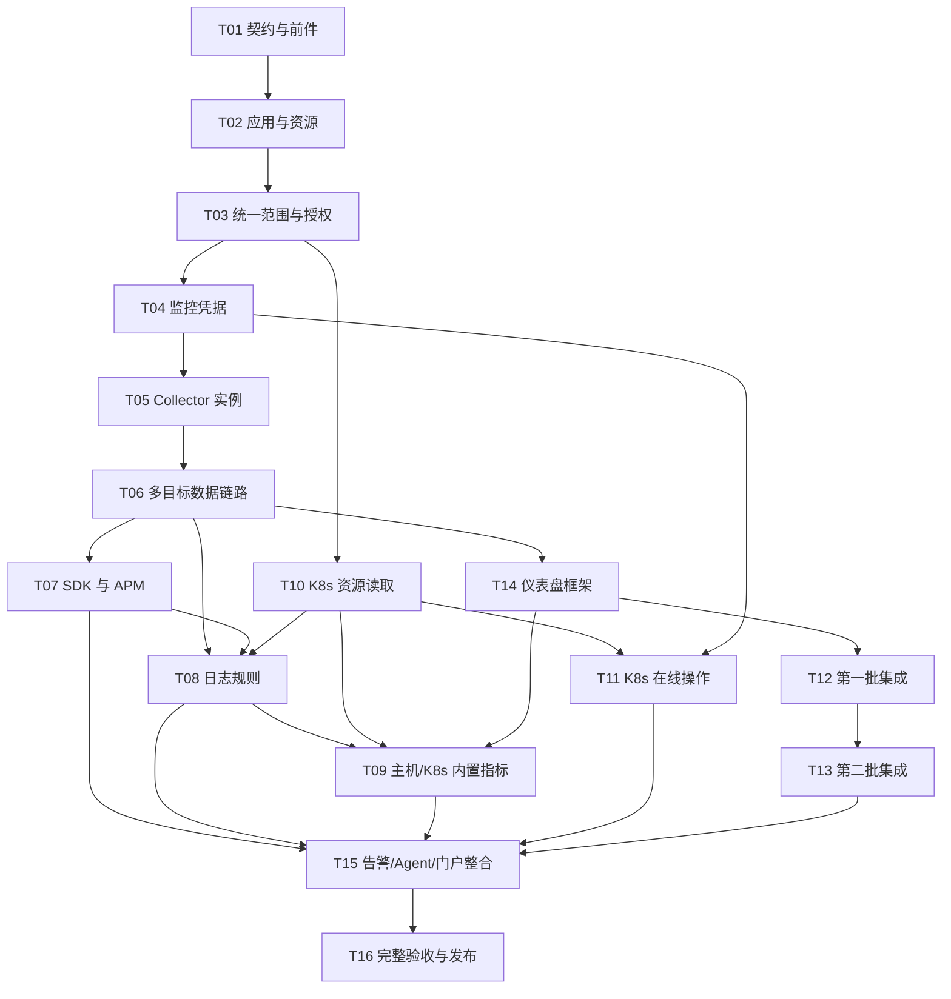

# 实施顺序、任务依赖与完成标准

## 任务总表

下表为任务及前件定义；实时状态见 `progress.json`。截至 2026-10-26，R88 的 T01–T15 完成，T16 因 P8-A64 历史目录保留证明未通过而继续保持未完成，详见[当前交付记录](./57-completion-delivery.md)。

| ID | 任务 | 前件 | 验收重点 |
| --- | --- | --- | --- |
| P8-T01 | [契约、基线与技术前件](./task-01-contracts-and-readiness.md) | 产品基线 | 契约样例覆盖同 Collector 多目标、生产/测试独立应用、共享依赖和未关联目标，无字段语义相互矛盾。 |
| P8-T02 | [应用、服务与稳定监控目标](./task-02-application-resource-domain.md) | T01 | 真实 PostgreSQL 验证唯一约束、事务、并发更新、重复提交、归档/删除依赖。 |
| P8-T03 | [统一范围解析与显式授权](./task-03-scope-and-authorization.md) | T02 | 真实数据库与查询引擎验证跨企业、跨应用、共享目标、混合类型、显式无权 ID、空范围、分页撤权和执行中撤权。 |
| P8-T04 | [监控专用凭据与敏感输入](./task-04-managed-credentials.md) | T02、T03 | 真实加密/租约链路证明跨用途、跨 owner、过期/撤销/重复兑换被拒绝，平台管理菜单不能越权代用。 |
| P8-T05 | [多实例编译、责任与运行状态](./task-05-collector-runtime.md) | T01、T02、T03、T04 | 同一 Collector 运行多条同类及异类任务，关闭/修改一条不错误删除其他配置。 |
| P8-T06 | [多目标身份、存储与来源链路](./task-06-trusted-telemetry.md) | T03、T05 | 真实 Collector→Ingest→Kafka→ClickHouse→Query 三信号验证混合目标、伪造身份、网关转发、迟到和重装历史。 |
| P8-T07 | [应用 SDK 接入、Key 与 APM](./task-07-application-ingest-apm.md) | T02、T03、T04、T06 | 使用实际 SDK 的请求调用链和业务日志验证服务环境、Key 轮换撤销、不同副本及跨应用可见性。 |
| P8-T08 | [主机、K8s 与 SDK 日志规则](./task-08-log-collection.md) | T04、T05、T06、T07、T10 | 实际文件写入/轮转与 Pod 滚动发布/换节点/重启验证连续性、来源、应用和错误状态。 |
| P8-T09 | [主机自身与 K8s 组件指标](./task-09-host-k8s-builtins.md) | T05、T06、T08、T10、T14 | 主机数值与实际系统观测对比；不同系统/容器可见范围注明，未观测字段不补 0。 |
| P8-T10 | [Kubernetes 资源视图与读取](./task-10-kubernetes-inventory.md) | T02、T03 | 真实 API 和 Connector 路径的同一查询返回一致身份；分页不漏/重复，Pod 重建/换名不接管旧身份。 |
| P8-T11 | [Kubernetes 在线变更与会话](./task-11-kubernetes-operations.md) | T03、T04、T10 | 真实集群执行创建、改镜像、扩缩容、重启、回滚、删除和 PVC 能力允许的扩容；以实际状态和事件核对结果。 |
| P8-T12 | [第一批服务与探测集成](./task-12-wave-one-integrations.md) | T04、T05、T06、T14 | 每个支持组合的 CONFIG/DATA/VIEW/AUTH/LIFECYCLE 五类门禁均有实际目标与运行版本证据。 |
| P8-T13 | [第二批服务与探测集成](./task-13-wave-two-integrations.md) | T12 | 18项均完成选型审查；支持组合通过五类门禁，缺项留证。 |
| P8-T14 | [仪表盘范围、模板框架与共享视图](./task-14-dashboard-templates.md) | T02、T03、T06 | 真实数据验证全局/局部、关系环境、K8s 子对象、不兼容过滤、无权/空范围与历史来源。 |
| P8-T15 | [告警、Agent 与门户整合](./task-15-alert-agent-and-portal.md) | T07、T08、T09、T11、T12、T13、T14 | 同一操作在门户/API/工具使用同一服务与权限；工具仅传 category 发现、先 Describe 后 Invoke，隐藏 Commit 不被发现。 |
| P8-T16 | [完整验收、迁移发布与回退](./task-16-acceptance-and-rollout.md) | T01、T02、T03、T04、T05、T06、T07、T08、T09、T10、T11、T12、T13、T14、T15 | 所有必需任务、Axx 门禁和集成子门禁通过且绑定同组源码/制品；未就绪外部环境明确阻止对应支持声明和全计划完成。 |

## 依赖图

图展示关键链路，精确前件以任务总表和 progress.json 为准。模块协作可按固定契约推进，但不能跳过前件把未验证接点记为完成。

`depends_on` 表示下游需要的契约/实现前件：接口、存储和被调用能力至少达到 implemented，并通过其本层的契约/真实依赖检查后，才能用于下游真实流程；不要求整个平台的组合门禁先通过才开始后续任务。任务文件的 Axx 是验收关联，共有门禁由所有 owner 的证据共同关闭。例：T02 提供 A07 的目标/实例事务，T04 提供凭据/租约部分，两者完成后才可把完整 A07 标为 passed；T01 的 Schema 检查不能单独关闭 A07。局部任务可记录自己的已验证交付，全量 Axx/集成/发布状态仍独立计算。

## 内部实施里程碑，最终统一交付

全部完成后一并上线。以下是开发/验证顺序，不是分批上线授权；39 候选经专用采集插件审查冻结支持范围（当前11资源及 SkyWalking 原生协议暂缓，27候选待验证），无合格内置组件的暂缓缺项单列，其他项全部验收后由 T16 统一发布。

| 阶段 | 任务 | 可评审结果 | 阶段退出条件 |
| --- | --- | --- | --- |
| M1 身份和契约 | T01～T04 | 应用/目标/授权/凭据的真实 API、Schema 和共享选择器基础 | 事务、用途/租约、环境继承、权限/空范围和生成物一致 |
| M2 数据面与基础框架 | T05、T06、T10、T14 | 多目标 Collector→存储→查询、K8s 读取、类型化 Dashboard 框架 | 真实混批/来源/转发、配置回滚、查询过滤与资源身份可靠 |
| M3 应用与资源运维 | T07～T09、T11 | 实际 SDK、日志规则、主机/K8s 指标和在线操作 | Key/日志映射/组件样本/在线操作及对应安全故障门禁通过 |
| M4 两批集成 | T12、T13 | 两批候选审查及支持组合模板，复用公共接入/日志 | 每个支持组合五类门禁通过；无合格内置组件的缺项留证，不把未验证当缺项 |
| M5 跨入口交付 | T15、T16 | 真实门户、告警、模型/Workspace 和同组制品发布 | 完整验收、必要外部环境、清理恢复、发布后真实样本均有证据 |

T14 负责模板/范围框架和真实代表场景，不负责提前宣称全部集成模板完成。T09、T12、T13 在框架上实现各自内容，解决“模板要等所有集成、集成又等模板”的循环依赖。T15 验证统一产品体验，不把前端全部积压到最后才做。

## 每项任务的统一交付要求

- PostgreSQL Schema/索引/事务、sqlc、领域服务、OpenAPI/protobuf/JSON Schema、生成客户端和错误契约同时落地。
- 服务端权限、目标/来源/关系校验、版本冲突、幂等、撤权与审计先于真实变更或数据读取。
- 相关门户与工具复用领域服务，UI 复用 `@argus/ui` 和 design tokens；real 模式缺配置失败关闭，不回退 mock。
- 同步中英、明暗、桌面布局、键盘和基础读屏。前后端单文件均小于 2000 行，新增模块保持清晰职责。
- 每项记录单元/契约/真实依赖/浏览器/实际组件/真实模型的验证范围；每个层级各自有结果，不用测试数量代替场景。
- 新集成更新发行清单、配置能力、查询目录、模板、告警建议、操作文档与运行时诊断。缺失能力是显式状态。
- 完成任务需要实现及其声明的门禁通过；完成整个 Plan8 还要求 T16 的全量组合和发布核验。部署状态单独记录。

## 建议端到端先行切片

先搭建真实代表链路：生产/测试各一个应用，由 SDK 发现服务；两个 MySQL 与 Redis/Nginx 由同一 Collector 采集。临时 Namespace 部署应用，验证 Namespace 授权、运维日志访问、真实 Trace/日志、独立停采、共享依赖、默认仪表盘和告警，再扩展目录。

这个切片用于验证共用架构，不能替代 SQL Server、Oracle、Windows/IIS、第二批所有组件或完整 K8s 操作验收。各集成仍有独立的版本和外部前件。

## 状态与证据

使用 [progress.json](./progress.json) 记录 task、integration 和 acceptance 三类状态。允许 `not_started/in_progress/implemented/verified/blocked`；`implemented` 不等于 `verified`。blocked 必须说明实际缺少的环境/事实与解除条件，不能把尚未检查的技术前件直接写成已阻塞。

任何任务若改变产品边界，更新 [决策](./01-scope-and-decisions.md)及相应设计文档；普通实现选型不额外增加用户审批。不得通过删除必需门禁、下调已冻结阈值或把 skip 写为 pass 来收尾。

本计划不预估未经验证的工期。T01 完成后结合目标版本、真实环境和测量结果再安排执行批次；每批提供源码/制品指纹、状态、失败记录和下一项可执行前件。
